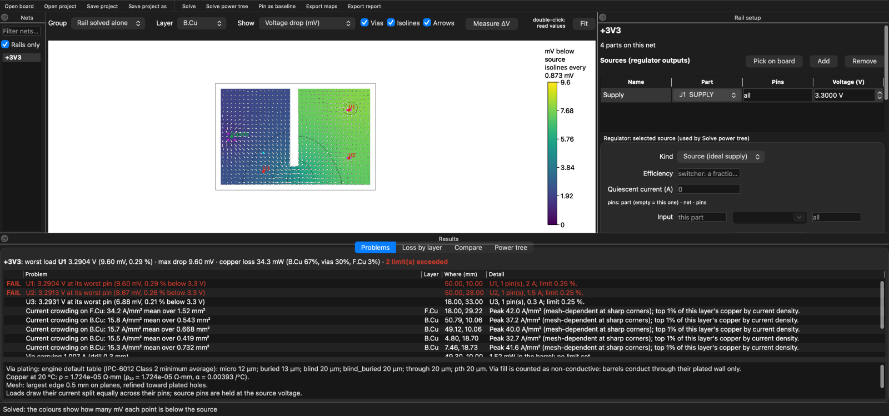
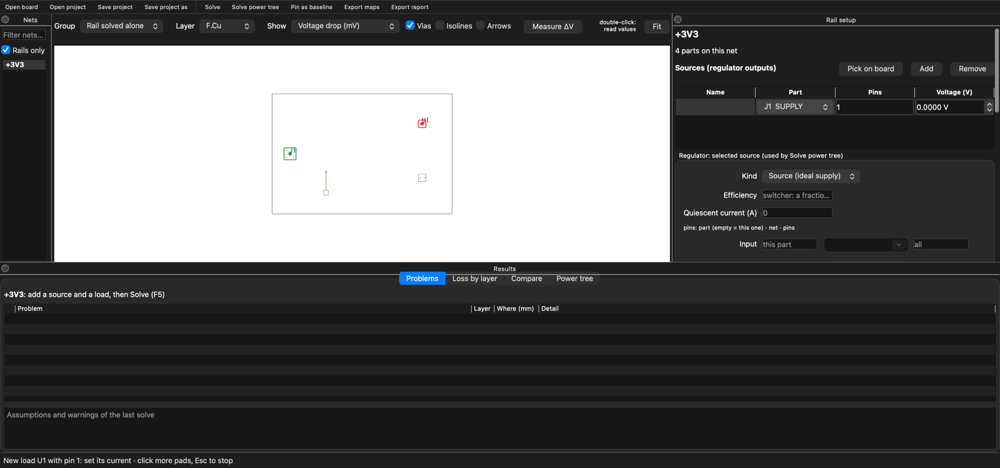
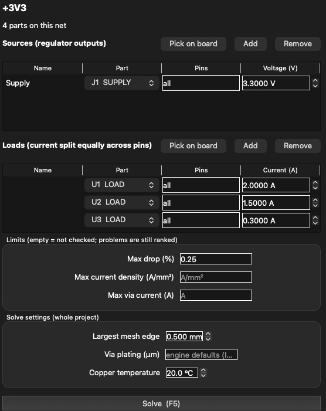
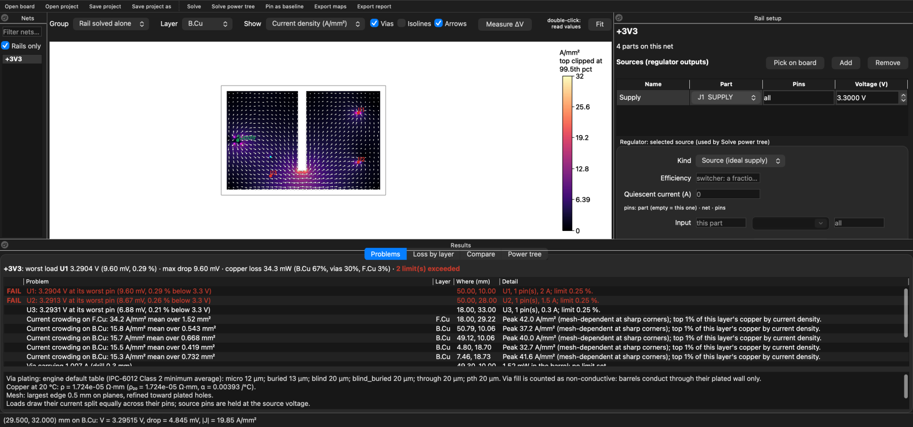
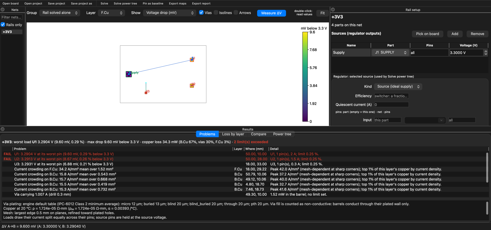
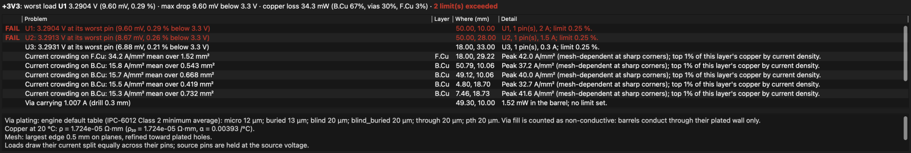
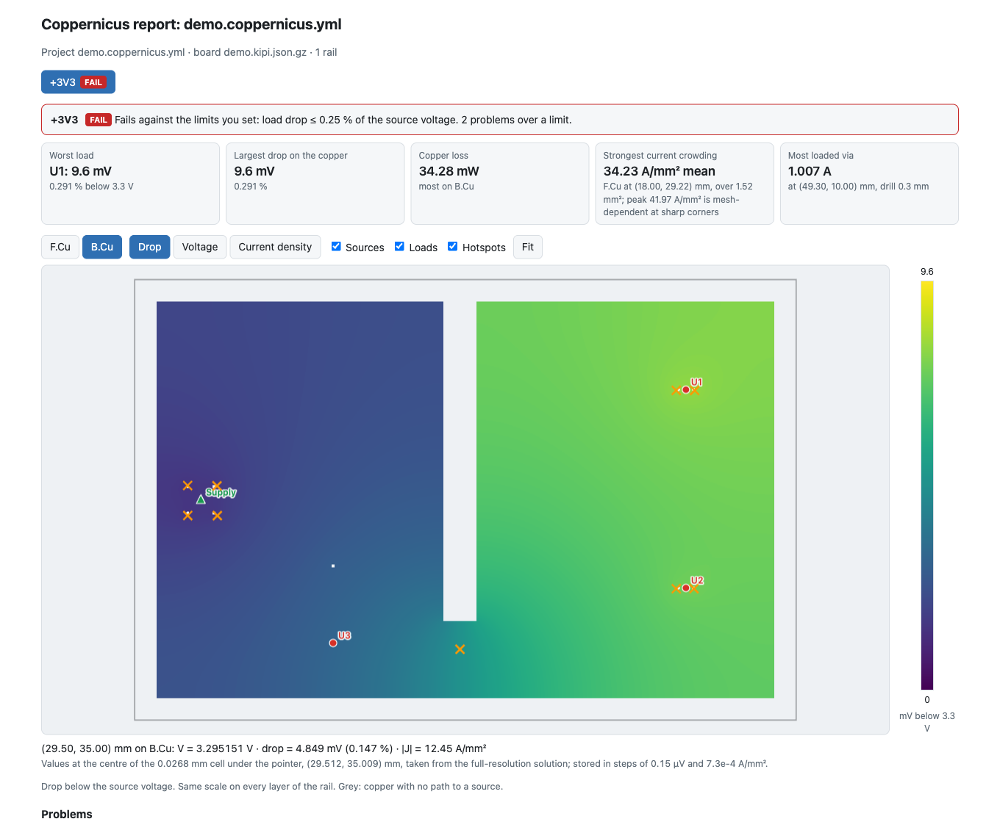

<p align="center">
  
</p>

<h1 align="center">Coppernicus</h1>

<p align="center">
  <em>See where your copper fails: a standalone DC power-integrity analyzer for KiCad PCBs.</em>
</p>

<p align="center">
  
  
  
  
</p>

---

> [!IMPORTANT]
> **Pre-alpha.** It works end to end, and the screens below are real, but the program is young.
> Check its results against your own judgement before you rely on them.

<p align="center">
  
</p>

## What it does

You have a KiCad board and a power net, say +3V3. Coppernicus tells you:

- **how much voltage each chip really gets**, after the copper between the regulator and the
  chip has eaten its share;
- **where the copper is crowded**: thin necks, narrow tracks, overloaded vias;
- **why**: which layer loses the most, which spot, which via.

It solves the real copper geometry on every layer (planes, pours, tracks, pads and vias) and
paints the results on the board. It is a **standalone program**: it reads the `.kicad_pcb` file
directly, never changes it, and does not need KiCad to be running.

All the pictures on this page come from the synthetic demo board in `examples/demo`.

## Install

**Packaged app (no Python needed):** a macOS `.dmg` (Apple silicon, macOS 14+) or a Windows `.zip`,
see [docs/install.md](docs/install.md). On first start it downloads the Triangle mesher from PyPI
once (its licence forbids bundling it), checks it against a known hash, and then works offline.

**From source:** you need [uv](https://docs.astral.sh/uv/). It installs Python and everything else, solver
included.

```sh
git clone https://github.com/RaffaeleBiondi/Coppernicus.git
cd Coppernicus
uv sync
uv run coppernicus            # opens the app
```

**On macOS you can get a double-clickable app.** Run `tools/make_mac_launcher.sh`. It builds
`~/Applications/Coppernicus.app` with the project icon, ready for the Dock or Launchpad. The app
starts Coppernicus from your copy of the repository, so it always runs the latest version you
have pulled. It works only on the machine where you built it. Rebuild it if you move the folder.

## Use it in six steps

Try it on the demo first: **Open project** → `examples/demo/demo.coppernicus.yml`.

### 1. Open a board and choose a net

Click **Open board** and choose a `.kicad_pcb` file. The list on the left shows the rails: the
power and ground nets, recognised by their names and copper pours. Untick *Rails only* to see
every net. If a rail is missing, right-click its net and choose **Mark as rail**; the choice is
saved in the project. Click the net you want to analyse.

### 2. Tell it where the current enters and leaves

The **source** is where the current enters, usually a regulator output. The **loads** are the
chips that draw the current. In the *Rail setup* panel on the right, press **Pick on board**
next to *Sources* and click the regulator's output pad on the board. Then press **Pick on
board** next to *Loads* and click the pads of each chip. Press **Esc** when you are done.

<p align="center">
  
</p>

Pads of the net are outlined while you pick. The source is green, the loads are red. A click on
a pad of another net is refused, and the status bar says why. You can also add rows with
**Add** and choose the part from a list.

### 3. Type the values

Give the source its voltage and each load its current. A load's current is split equally across
the pins you picked. To use every pin of a part, write `all`.

<p align="center">
  
</p>

**Limits are optional, and there are no default limits.** Without limits, Coppernicus ranks what
it finds but never says pass or fail. If you set a limit, anything beyond it is marked
**FAIL**. The limits are maximum drop (%), maximum current density (A/mm²) and maximum current
per via (A).

### 4. Solve and read the drop map

Press **Solve** (or **F5**). The board turns into a map of **how many millivolts each point is
below the source**. The view opens on the layer that loses the most power, and the *Layer* menu
shows the others. Drag to pan, use the wheel to zoom, and press **Fit** to see the whole board.

Tick **Isolines** to draw lines of equal drop, at the same levels on every layer, and
**Arrows** to show which way the current flows. A longer arrow means more current. In the
picture at the top, the slot in the plane forces the current through the neck below it, so the
loads on the far side get less voltage.

### 5. Find where the copper is crowded

Set *Show* to **Current density (A/mm²)**. Bright areas carry a lot of current through little
copper. **Double-click** anywhere to read the voltage, the drop and the current density at that
point in the status bar.

<p align="center">
  
</p>

To measure the voltage difference between two points, press **Measure ΔV** and click point A,
then point B. The status bar shows ΔV A→B and both voltages. Press **Esc** to stop.

<p align="center">
  
</p>

### 6. Read the results

The *Results* panel at the bottom has three tabs. **Problems** lists, in order:

- every load, with the voltage it gets;
- the most crowded spots;
- the vias that carry the most current.

Click a row to zoom to it. The first line sums the rail up: worst load, total copper loss and
where it is lost (per layer and in the vias). Underneath, the **assumptions** of the solve are
listed: via plating, copper temperature and mesh size.

<p align="center">
  
</p>

> The two FAIL rows come from the demo project's own limit, a 0.25 % maximum drop, which is
> deliberately tight. Coppernicus has no built-in thresholds.

**Loss by layer** draws the copper loss of each layer as a bar chart.

**Compare** shows what a change does. Press **Pin as baseline** (Ctrl+B), change something (a
current, the via plating, or the board itself in KiCad), and solve again. The tab lists the
change in drop of every load and in loss per layer. *Show → Δ drop vs baseline* paints where
the drop grew (red) or shrank.

**Export report** (Ctrl+R) writes the offline HTML report described under
[Command line](#command-line), to send to someone who does not have Coppernicus.

Finally, **Save project**. It writes a small `*.coppernicus.yml` file with the board path, the
rails, their sources, loads and limits. Open it again later, or use it from the command line.

### The whole power tree, ground included

One rail at a time is the quick check. When regulators feed each other (12 V → switcher →
3.3 V → LDO → 1.8 V), press **Solve power tree** (Ctrl+T) to solve every rail and the ground
together. Try it on `examples/power_chain/power_chain.coppernicus.yml`.

- Each regulator is a load on the rail that feeds it. Its input current comes from its output:
  an LDO draws I_out + I_q; a switcher draws V_out·I_out / (η·V_in) + I_q.
- The return current flows in the ground copper, so ground rises above 0 V away from the
  supply. A load's drop counts both sides: nominal minus (supply pin − ground pin).
- The **Power tree** tab lists every regulator (voltages, currents, loss) and every load (the
  voltage across its pins). **Group** shows one rail or the ground net on the board.
- Click a regulator under **Sources** to set its kind (LDO or switcher), efficiency, quiescent
  current and input, ground and sense pins.
- On a ground net, **Max ground rise (mV)** is an optional limit.
- A group passes only when everything its limits apply to was judged. A load behind a regulator
  out of regulation, or a disconnected one, is listed as *not judged*, never as a pass.

A rail solved on its own (F5) also draws the regulators it feeds, with their input current
estimated at nominal voltages; its assumptions say so.

## What the numbers mean

- **Drop**: source voltage minus the voltage at a point, in mV. For a load, the worst of its pins.
- **Current density |J|**: current per copper cross-section, in A/mm². A crowding spot is ranked
  by its average |J|. The peak value at a sharp inner corner depends on the mesh, so treat it as
  a hint, not a number.
- **Via current**: the current through one plated hole. The barrel is modelled with the plating
  thickness listed in the assumptions.
- **Copper loss**: I²R power lost in the copper, per layer and in the vias.

How hot a track gets for a given current depends on the copper, the layer, the board and the
airflow. Coppernicus does not guess it for you. Set the limits your design rules call for.

## Command line

Everything the app solves can also be run without a window, in scripts or in CI:

```sh
uv run coppernicus nets board.kicad_pcb                  # power and ground nets
uv run coppernicus parts board.kicad_pcb +3V3            # parts and pins on a net
uv run coppernicus solve project.coppernicus.yml         # solve every rail of a project
uv run coppernicus solve project.coppernicus.yml --tree  # the whole power tree, ground included
uv run coppernicus gui project.coppernicus.yml --solve +3V3 --field current
```

Add `--json` to `nets`, `parts` or `solve` to get one JSON document on stdout instead of text.
The `*_summary.json` file that `solve` writes holds the same document.

`solve` prints a report per rail and writes a PNG map per layer plus a JSON summary into
`results/`, next to the project file. It exits with **0** when everything is within your
limits, **1** when a limit is exceeded and **2** on an error.

**HTML report.** Add `--html` to `solve` (and `--open` to open it straight away). Coppernicus
writes one offline HTML file next to the summary. It holds every rail and copper layer as voltage
drop, voltage or current density, with zoom, pan and a readout under the mouse, plus the problems
table (click a row to zoom), the worst values per rail and the assumptions. It needs no network,
so you can send it to a colleague. On a 10-layer board with four rails it weighs about 6 MB.

```sh
uv run coppernicus solve project.coppernicus.yml --html --open
```

<p align="center">
  
</p>

## Use it in CI

Coppernicus is also a GitHub Action. Add a workflow to your KiCad repository with
`uses: RaffaeleBiondi/Coppernicus@main` and `project: hardware/*.coppernicus.yml`. On every push
it solves the rails of your project files and writes a summary on the run's page: worst load,
drop, loss and verdict per rail. It attaches the maps and the interactive HTML report, and fails
the check when a limit you wrote in a project file is exceeded. See [docs/ci.md](docs/ci.md).

## Use it from an AI agent

`coppernicus mcp` is an [MCP](https://modelcontextprotocol.io) server over stdio. With it,
Claude Code, Claude Desktop or another MCP client can open a board, solve rails, read the drop
and current density, render maps, measure a cross-section, compare what-ifs, and solve a project's whole power tree. An agent that
only has a shell can use `--json` on `nets`, `parts` and `solve` instead. Registration, the
tools, conventions and a worked example are in [docs/agents.md](docs/agents.md).

For Claude Code there is also a skill that teaches the agent how to use these tools well. It
shows the order of the calls and the answer to give: numbers, then a verdict only against your
limits, then where and why. It also tells the agent never to invent thresholds. Install it
once:

```sh
mkdir -p ~/.claude/skills
cp -r skills/analyzing-pdn-with-coppernicus ~/.claude/skills/
```

It starts by itself when you ask Claude whether a rail holds, about voltage drop, current
density, via current or copper heating.

## Project file

The app writes the project file for you, and it is also easy to edit by hand:

```yaml
board: demo.kipi.json.gz          # relative to this file; a .kicad_pcb works the same way
settings:
  max_edge_mm: 0.5                # largest mesh edge on planes
  via_plating_um: null            # null = engine table (IPC-6012 Class 2 minimum average)
  copper_temp_c: 20.0             # resistivity is referenced to 20 °C
  copper_thickness_mm:            # optional what-if, mm per copper layer (1 oz = 0.035, not 35)
    B.Cu: 0.07                    # the board file is not changed; real changes are made in KiCad
rails:
- net: +3V3
  sources:
  - name: Supply
    ref: J1
    pins: all                     # or a list of pad numbers; globs like "A*" work
    voltage: 3.3
  loads:
  - ref: U1
    pins: all
    current: 2.0                  # split equally across the pins
  limits:
    max_drop_pct: 0.25            # optional; also max_current_density, max_via_current
```

`copper_thickness_mm` is optional. When set, every solve of the project (app, CLI, MCP, GitHub
Action, power tree) uses that copper instead of the board file's, and the assumptions name the
overridden layers. Leave it out to solve the board as designed. A ground net takes
`max_ground_rise_mv` as its limit. Regulator details (kind, efficiency, input and ground pins)
and links such as ferrites are described in [docs/engine-mapping.md](docs/engine-mapping.md).

**Values from KiCad.** If the board's parts carry power fields, put on the symbol in the schematic
and copied to the footprint by *Update PCB from Schematic*, Coppernicus reads them by default:
`PI_RAIL: +3V3`, `PI_SOURCE: 3.3V`, `PI_LOAD: 2A`, `PI_KIND: ldo`, `PI_INPUT: VIN`, `PI_GND: GND`,
`PI_LINK: 50mOhm`… Every value needs its unit. They win over a project rail of the same net, and a
warning lists the differences. Set `override_board_fields: true` on that rail to keep yours, or
`use_board_fields: false` to ignore the fields. `coppernicus fields board.kicad_pcb` lists them.

## Status

| Feature | Status |
|---|---|
| Voltage-drop, voltage and current-density maps, one layer at a time | ✅ |
| Problems panel: loads ranked by drop, crowding spots, loaded vias; click to zoom | ✅ |
| Pass/fail only against limits you set | ✅ |
| Copper loss per layer and in the vias | ✅ |
| Net ties found automatically and solved as shorts | ✅ |
| Sources and loads picked by clicking pads ("Pick on board"); pads of another net are refused with a message | ✅ |
| Double-click readout of V, drop and \|J\| | ✅ |
| Drop isolines (the same levels on every layer) and current-flow arrows (length ∝ √\|J\|) | ✅ |
| ΔV between two clicked points ("Measure ΔV") | ✅ |
| Nets marked as rails by hand, saved in the project (right-click a net) | ✅ |
| Command line with exit codes for scripts and CI | ✅ 0 no limit exceeded (or none set), 1 a limit exceeded, 3 a limit you set could not judge something, 2 an error (a crash too) |
| AI-agent interface: MCP server (with `solve_tree` for the whole power tree) and `--json` on the CLI ([guide](docs/agents.md)) | ✅ first version (registration in a real Claude host not yet tried) |
| Offline interactive HTML report (`solve --html`, MCP `report` tool); `solve --tree --html` for the whole power tree | ✅ (tested in Chromium and Chrome; Safari and Firefox not yet) |
| Power-tree report: each group's loads and worst card show the tree's judged values (across supply and ground pins, from nominal); `report.html#group=NET` opens a group | ✅ |
| GitHub Action for KiCad repositories (`uses: RaffaeleBiondi/Coppernicus@main`), job summary, artifacts; `fail-on-not-judged` (default on) fails on a limit that could not judge; opt-in `tree` adds the power tree's tables to the job summary | ✅ |
| Sources, loads, converters and links defined in KiCad footprint fields (`PI_RAIL`, `PI_SOURCE`, `PI_LOAD`, `PI_KIND`, `PI_INPUT`, `PI_GND`, `PI_LINK`…) | ✅ read by default from `.kicad_pcb` in the CLI, MCP and Action; KiCad wins over a project rail unless `override_board_fields: true` ([fields](docs/agents.md#kicad-footprint-fields)) |
| KiCad fields, second step: library-level part data without `PI_RAIL` (`PI_KIND`, `PI_EFF`, `PI_IQ`, `PI_VOUT`, `PI_IMAX`, `PI_FSW`), external-inductor bucks (`PI_SOURCE_REF`), links on multi-net parts such as load switches (`PI_LINK_PINS`); I_max judged in the power tree (below) ([how to annotate](docs/agents.md#how-to-annotate-a-kicad-library)) | ✅ |
| KiCad fields, third step: one source terminal on several parts (`PI_SOURCE_REF=BT1,BT5`, e.g. cell holders in parallel; project key `extra_pins`) and ground pins on another part (`PI_GND_REF`) | ✅ |
| Regulator ratings: a regulator or source over its rated output current (KiCad `PI_IMAX` or `current_limit_a`) fails in the power tree, naming where the rating was written; not judged while the tree has not settled or the rail is not solved; the app's Power tree tab shows I max next to I out | ✅ |
| `coppernicus fields` and the MCP `board_fields` call a rail complete as a solve does (a load net behind a link, a source feeding a link or a regulator input) and say what completes it; each power-tree problem carries its detail, place and the limit that judged it with the net it came from (`limit_pct`/`limit_mv`, `limit_from`) | ✅ |
| The app reads the KiCad fields: rails from KiCad are listed [KiCad] and read-only, with Override in project for a what-if; Project → Use KiCad footprint fields turns them off; File → Reload board (Ctrl+Shift+R). Example: `examples/fields` | ✅ |
| Before/after comparison: "Pin as baseline", Compare tab (per-load, total and per-layer deltas, settings that changed), "Δ drop vs baseline" map | ✅ |
| Copper loss by layer as a chart (baseline beside current) | ✅ |
| Offline HTML report exported from the app (Export report…, Ctrl+R) | ✅ |
| Readout while hovering: a label next to the pointer; View → Hover shows picks V, drop, \|J\|, layer, net (double-click still pins a point) | ✅ |
| The double-click reads exactly the point under the pointer, as the hover does; a ground below 0 V reads as a ground shift; a solve whose setup changed meanwhile is dropped with a message | ✅ |
| Project file v2: regulator kind (source / LDO / switcher), efficiency, quiescent current; input, ground and remote-sense pins; load ground pins; links (ferrites, sense resistors, fuses). Old project files load and save unchanged | ✅ (regulators editable in the app; links set in the project file) |
| Power tree with ground return: regulators as loads on the rail feeding them, ground rise, remote sense; Solve power tree (Ctrl+T), Group selector, Power tree tab; `solve --tree` (and `--json`); MCP `solve_tree` | ✅ |
| A rail solved alone draws the regulator inputs and links it feeds, estimated at nominal voltages | ✅ in the app, the CLI (`solve`, `--json`, `--html`), MCP `solve_project` and the Action; MCP `solve_rail` has no project |
| Optional ground-rise limit (`max_ground_rise_mv`) on a ground net | ✅ (single-rail solves, the power tree, MCP, report and CI summary) |
| Each limit judges its own kind of net: `max_ground_rise_mv` nets at 0 V (grounds), `max_drop_pct` nets with a nonzero nominal; one set on the other kind is reported as not judged, and the rail panel disables the field that does not apply | ✅ |
| Negative rails (type a negative source voltage) and nets at 0 V solved alone show their real voltages: a negative rail's loads sit toward 0 V, a ground rises above 0 V, as in the power tree | ✅ |
| Verdicts list what a set limit could not judge (`not_judged`, with the reason), in JSON, CLI text, report and CI summary | ✅ |
| AI agents can set up and edit project files (`write_project`, `read_project`) | ✅ explicit path, no overwrite without `overwrite: true`, checked before saving |
| KiCad field proposals for a project (`propose_fields`, `coppernicus fields --propose`) | ✅ text to paste into KiCad (library symbol vs schematic instance); KiCad files are never written |
| Compare two revisions of a board (`compare_revisions`) | ✅ per-load and per-layer deltas, via currents, where the drop changed, a Δ map |
| One-step copper weight what-if for agents (`copper_step`; `solve_rail` settings follow the same rule) | ✅ 0.5 / 1 / 2 / 3 oz, one step from the design; bigger changes are made in KiCad |
| Power-tree verdicts: a group passes only when everything its limits apply to was judged. Items that cannot be judged (disconnected, behind a regulator out of regulation, not converged, 0 V nominal, a limit on a net the tree does not solve) give "not judged" and are named | ✅ |
| Regulator inputs judged as loads on the rail feeding them (across input and ground pins); limits per net, a net without its own limit takes its group's main rail's; copper judged against the strictest limit in the group, and a fail names whose limit it used | ✅ |
| What-if copper thickness per layer (`copper_thickness_mm`, optional, at most 1 mm per layer) | ✅ (project file, MCP, and the app: Solve settings → Copper thickness → Edit…; empty = board file) |
| The window fits a 1440 px screen (map bar on two rows) | ✅ |
| Cleared fields mean "not set"; the mouse wheel changes a field only when it is focused; reports fall back to `~/Documents/Coppernicus/results` on a read-only volume; packaged app: Help → Remove downloaded mesher (a mesher in use, e.g. on Windows, is removed at the next start) | ✅ |
| Board temperature (electro-thermal, with the power tree): temperature per layer, the copper heating the drop; `thermal:` in the project or `solve --thermal`; a verdict only against `max_temp_c` / `max_rise_c`. Example: `examples/demo/demo-thermal` | ✅ CLI and app: Temperature tab (options and limits, hottest copper per layer with the nearest part, history, a cost and memory estimate before solving, Cancel) and a Board temperature map with hover readout |
| Board temperature for agents and CI: MCP `solve_tree` takes `thermal` and `thermal_options`, gives a size and memory estimate first and refuses a solve over this machine's memory unless confirmed (`solve_too_large`); a Board temperature section with each layer's map in the tree report; CI judges it with the `tree` input (1 fail, 3 not judged); rail by rail its limits are listed as NOT JUDGED | ✅ |
| AC PDN impedance \|Z\|(f) per probe: `coppernicus ac PROJECT` (CSV + PNG); a verdict only against your target (or KiPI's formula from your tolerance, step and slew). Example: `examples/pdn` | ✅ CLI and app: Impedance tab (probes, capacitor models and sweep edited and picked on the board, cost and memory estimate before solving, \|Z\|(f) plot with your target and the not-judged band, Cancel, CSV/PNG export, Ctrl+I) |
| Ripple and coupled noise: `coppernicus noise PROJECT` wraps KiPI's solve_noise: the regulators' ripple and each victim's coupled noise at its receiver, judged only against a noise margin you set; not judged while one of KiPI's defaults stands in (Coss/Qrr, a missing switch net, a listed capacitor KiPI draws no loop for, harmonics cut short). Example: `examples/noise` | ✅ CLI and app (Ripple & noise tab: aggressors, phases, victims, waveforms and field maps, Cancel, export) |
| AC PDN impedance for agents and CI: MCP `solve_ac` (CSV/PNG paths, a size and memory estimate first, refused over this machine's memory unless confirmed), `coppernicus ac --html`, the Action's opt-in `ac` input (1 fail, 3 not judged) | ✅ |
| Ripple and coupled noise for agents and CI: MCP `solve_noise` (CSV/PNG paths, a size and memory estimate first, refused over this machine's memory unless confirmed), `coppernicus noise --html`, the Action's opt-in `noise` input (1 fail, 3 not judged; the ripple and the radiated estimate are never judged) | ✅ |
| Tolerance budget | ⏳ (KiPI's engine has it) |
| Packaged app: macOS `.dmg`, Windows `.zip`; Triangle fetched once on first start, checked against `uv.lock` ([install](docs/install.md)) | ✅ macOS built and tried; Windows built by CI, not yet tried; unsigned |

Tested on macOS. The test suite runs in CI on Ubuntu, macOS and Windows, all required; the desktop app itself has not been tried on Windows yet. The engine also reads ODB++
and HyperLynx files, which have not been tried through Coppernicus yet.

## More documentation

- [Installing the packaged app](docs/install.md).
- Feature guides: [power tree](docs/power-tree.md), [KiCad fields](docs/kicad-fields.md), [what-if and compare](docs/what-if-and-compare.md), [HTML report](docs/html-report.md), [board temperature](docs/thermal.md), [PDN impedance](docs/ac-impedance.md), [ripple and coupled noise](docs/noise.md), [CI](docs/ci.md), [agents](docs/agents.md).
- [How it works](docs/technical.md): architecture, physics, validation, repository layout.
- [Stage-1 analysis of KiPI](docs/kipi-analysis.md), the engine underneath.
- [Workstreams](docs/workstreams.md) and the [roadmap plan](docs/superpowers/plans/2026-11-24-coppernicus-roadmap.md).

## Acknowledgements

- **[KiPI](https://github.com/drewsum/KiPI)** by Drew Maatman (GPL-3.0-or-later). Its engine
  does the import, meshing and solving.
- **[padne](https://github.com/atx/padne)** by Josef Gajdusek (GPL-3.0): KiCad-native 2.5D FEM
  DC voltage-drop solver. Prior art.
- KiPI meshes with [Triangle](https://www.cs.cmu.edu/~quake/triangle.html) by J. R. Shewchuk,
  whose notice reads in part: *"Private, research, and institutional use is free. […]
  Distribution of this code as part of a commercial system is permissible ONLY BY DIRECT
  ARRANGEMENT WITH THE AUTHOR."* The full text is quoted in the [analysis](docs/kipi-analysis.md).

## License

Coppernicus is free software under the **GNU General Public License v3.0 or later**. See
[LICENSE](LICENSE).
