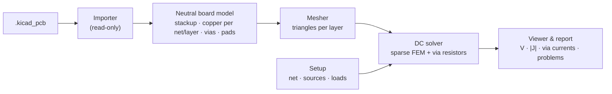

<p align="center">
  
</p>

<h1 align="center">Coppernicus</h1>

<p align="center">
  <em>See where your copper fails: a standalone DC power-integrity analyzer for KiCad PCBs.</em>
</p>

<p align="center">
  
  
  
  
</p>

---

> [!IMPORTANT]
> **Coppernicus is in the evaluation and design phase.** There is no runnable code yet.
> This README describes the goal, the roadmap and the *proposed* architecture. A quick-start
> section will be added once there is a command that actually works.

## What it is

Coppernicus is a desktop application (macOS and Windows) for **DC power-delivery-network (PDN)
analysis** of printed circuit boards designed in **KiCad**.

You open a board, pick a power net, tell Coppernicus **where the current enters** (a regulator
output at a known voltage) and **where it leaves** (loads and the current each one draws), and it
solves the current flow through the real copper geometry: planes, pours, tracks, pads and vias,
on every layer.

The two results that matter most are drawn as colour maps on top of the board:

- **Voltage drop (IR drop)**: how much voltage each load actually receives, and where it is lost.
- **Current density**: where the copper is crowded, from neck-downs and thin bridges to
  overloaded vias.

Coppernicus is a **standalone program**, not a KiCad plugin: it reads board files directly and
does not need KiCad to be running.

## Design goal: explain *where* and *why* a board fails

Most PDN tools show a colour map and leave the interpretation to you. Coppernicus aims to
point at the problem directly:

| Feature | What it answers |
|---|---|
| Per-layer 2D view with voltage and current-density maps, drop isolines and current-flow arrows | *Where does the current go, and where is it lost?* |
| Vias drawn by the current they carry, flagged above a limit | *Which vias are overloaded?* |
| **Problems panel**: out-of-spec loads, bottlenecks, hot vias; click to zoom | *What should I fix first?* |
| **Drop breakdown** per layer, segment and via | *Which part of the path eats my voltage budget?* |
| Hover probe (V, ΔV, J, layer) and point-to-point ΔV | *What is the drop between these two points?* |
| Before/after comparison of two runs, HTML/PDF report | *Did my layout change help?* |

## Roadmap

| Stage | Scope | Status |
|---|---|---|
| 0 | Repository setup | ✅ done |
| 1 | **Study of [KiPI](https://github.com/drewsum/KiPI)**: physics, numerics, board import, UX. Run it on real boards and measure accuracy and speed against analytic cases | 🔄 in progress |
| 2 | Architecture decision: a new front-end on top of KiPI's core, or a reimplementation | ⏳ planned |
| 3 | **DC MVP**: board import, mesh, multilayer DC solver, CLI with YAML setup, colour maps | ⏳ planned |
| 4 | **Desktop app**: net list, sources and loads by click or `REF.PAD`, maps, problems panel, drop breakdown | ⏳ planned |
| 5 | Packaging for macOS (`.app`) and Windows (`.exe`) | ⏳ planned |
| Later | Ground return path, electro-thermal coupling (I²R heating, ρ(T)) | 💡 idea |
| Later | **AC / PDN impedance**: Z(f) at load pins, plane-pair cavity model, decoupling capacitors (C/ESR/ESL or S-parameters), mounting inductance, VRM model, target impedance | 💡 idea |
| Later | **DC-DC ripple**: switching frequency and harmonics propagated through the PDN to every point of interest | 💡 idea |

## How it works (proposed)

> [!NOTE]
> The architecture and stack below are **proposals** and will be confirmed at the end of
> stage 1.



**Physics.** On each copper layer the potential V obeys ∇·(σ·t·∇V) = 0, where σ is the copper
conductivity and t the copper thickness, i.e. a sheet of resistance ρ/t per square. Layers are
connected by vias modelled as resistors, using the barrel resistance from drill diameter and plating
thickness. Regulator outputs are fixed-voltage boundaries and loads are current sinks on their pads.
Parameters that are not stored in the board file, such as via plating thickness and copper
temperature, are **explicit inputs with stated defaults**, never hidden constants.

**Proposed stack:** Python 3.12 · PySide6 (Qt) · NumPy / SciPy (sparse solvers) · Shapely ·
packaging with PyInstaller.

**Board input:** KiCad `.kicad_pcb`. Other formats (ODB++, IPC-2581) may follow through the
same neutral board model.

## Repository layout

```text
Coppernicus/
├── README.md
├── .gitignore
├── Logo/                 # project logo (transparent and white-background versions)
└── docs/                 # design notes, KiPI analysis (stage 1)
```

The layout will grow as stages 2–4 land (`coppernicus/` package, `tests/`, packaging scripts).

## Validation strategy

The solver will be checked against cases with known answers before it is trusted on real boards:

- a straight strip, R = ρL / (w·t)
- a single via against the barrel-resistance formula
- current balance: the sum of load currents equals the source current
- disconnected copper islands rejected with a clear error
- cross-checks against KiPI on the same geometry

Real production boards are kept out of this repository. Tests use synthetic geometry and small
hand-drawn test boards.

## Prior art and acknowledgements

- **[KiPI](https://github.com/drewsum/KiPI)** by Drew Maatman (GPL-3.0): DC, AC and coupled-noise
  power-integrity analysis for KiCad, as a plugin or standalone. It is the reference
  implementation studied in stage 1 ([analysis](docs/kipi-analysis.md)).
- **[padne](https://github.com/atx/padne)** by Josef Gajdusek (GPL-3.0): KiCad-native 2.5D FEM
  DC voltage-drop solver. Prior art.

## License

All rights reserved. The license will be decided at a later stage.
