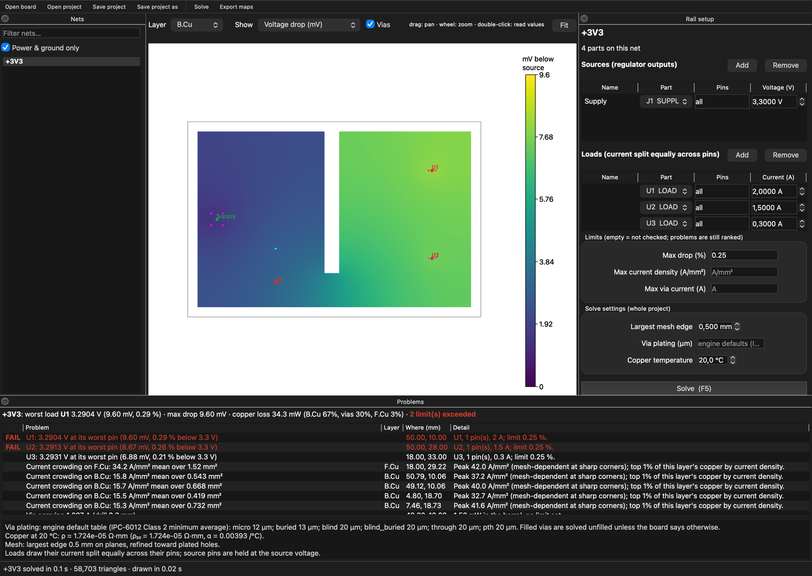
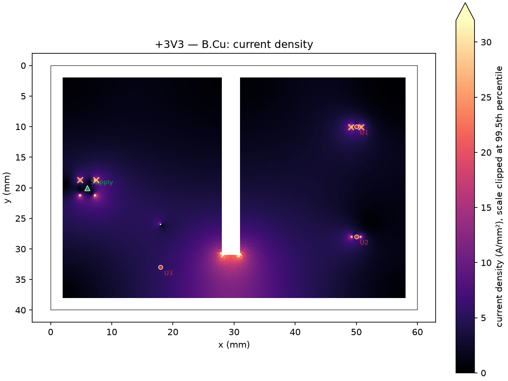
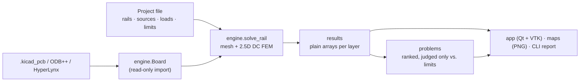

<p align="center">
  
</p>

<h1 align="center">Coppernicus</h1>

<p align="center">
  <em>See where your copper fails: a standalone DC power-integrity analyzer for KiCad PCBs.</em>
</p>

<p align="center">
  
  
  
  
</p>

---

> [!IMPORTANT]
> **Pre-alpha.** The solver engine, the command line and a first desktop app work end to end,
> and the GUI layout is a first draft that will change. Results should be checked against
> your own judgement before you rely on them.

<p align="center">
  
</p>

## What it is

Coppernicus is a desktop application and command-line tool for **DC power-delivery-network
(PDN) analysis** of printed circuit boards designed in **KiCad**.

You open a board, pick a power net, say **where the current enters** (a regulator output at a
known voltage) and **where it leaves** (loads and the current each one draws). Coppernicus then
solves the current flow through the real copper geometry, on every layer: planes, pours,
tracks, pads and vias.

The two results that matter most are drawn as colour maps on the board:

- **Voltage drop (IR drop)**: how much voltage each load really gets, and where it is lost.
- **Current density**: where the copper is crowded, from neck-downs and thin tracks to the
  copper around vias.

It is a **standalone program**, not a KiCad plugin. It reads `.kicad_pcb` files directly and does
not need KiCad to be running. Board files are only ever read. The engine also reads ODB++ and
HyperLynx files, but those have not been tried through Coppernicus yet. Developed and tested on
macOS; Windows is a target but has not been tested yet.

## Design goal: explain *where* and *why* a board fails

| Feature | Status |
|---|---|
| 2D view, one copper layer at a time, with voltage-drop, voltage and current-density maps | ✅ |
| Opens on the layer where the rail loses the most power | ✅ |
| **Problems panel**: every load ranked by drop, current-crowding spots and the most loaded vias. Click a row to zoom to it | ✅ |
| Pass/fail only against limits *you* set (drop %, A/mm², A per via). Without limits, problems are ranked and never judged | ✅ |
| Copper-loss breakdown per layer and for the vias | ✅ (summary line) |
| Double-click probe (V, drop, \|J\|) | ✅ readout tested; the mouse double-click itself not yet |
| Net ties found automatically (checked on a real board) and solved as shorts (tested on a synthetic board) | ✅ |
| Sources and loads picked by clicking pads on the board | ⏳ |
| Drop isolines, current-flow arrows, point-to-point ΔV | ⏳ |
| Before/after comparison, HTML/PDF report | ⏳ |

## Quick start

Requires [uv](https://docs.astral.sh/uv/). It installs Python 3.12 and every dependency,
including the solver engine.

```sh
git clone git@github.com:RaffaeleBiondi/Coppernicus.git
cd Coppernicus
uv sync

# A synthetic demo board ships in examples/demo
uv run coppernicus solve examples/demo/demo.coppernicus.yml --out results/demo
uv run coppernicus gui examples/demo/demo.coppernicus.yml

# Your own board
uv run coppernicus nets path/to/board.kicad_pcb            # power and ground nets
uv run coppernicus parts path/to/board.kicad_pcb +3V3      # parts and pins on a net
uv run coppernicus gui path/to/board.kicad_pcb             # set up rails in the app, save a project
```

`solve` prints a report per rail, writes per-layer PNG maps and a JSON summary, and exits with
`1` when a limit you set is exceeded (`2` on errors). That makes it usable in scripts and CI.

### macOS launcher

```sh
tools/make_mac_launcher.sh            # builds ~/Applications/Coppernicus.app
```

This builds a double-clickable `Coppernicus.app` with the project icon, which you can keep in
the Dock or in Launchpad. It contains no Python: it starts the app from this checkout with
`uv run`, so it only works on the machine where it was built. Rebuild it if you move the
repository. A standalone, distributable app comes with the packaging stage. Known cosmetic issue:
the menu bar shows "Python" as the app name.

<p align="center">
  
</p>

### Project file

A project (`*.coppernicus.yml`) names the board and lists the rails to solve. The app writes it
for you, and it is also easy to edit by hand:

```yaml
board: demo.kipi.json.gz          # relative to this file; .kicad_pcb works the same way
settings:
  max_edge_mm: 0.5                # largest mesh edge on planes
  via_plating_um: null            # null = engine table (IPC-6012 Class 2 minimum average)
  copper_temp_c: 20.0             # resistivity is referenced to 20 °C
rails:
- net: +3V3
  sources:
  - name: Supply
    ref: J1
    pins: all                     # or a list of pad numbers; globs like "A*" work
    voltage: 3.3
  loads:
  - ref: U1
    pins: all
    current: 2.0                  # split equally across the pins
  limits:
    max_drop_pct: 0.25            # optional; also max_current_density, max_via_current
```

## How it works



**Engine.** The DC solver is [KiPI](https://github.com/drewsum/KiPI)'s engine, pinned to its
v1.0.1 commit. Coppernicus only talks to it through `coppernicus.engine`, the one package that
imports KiPI. A different engine can be put in by rewriting that package alone.

**Physics** (KiPI's DC model, checked in stage 1, see [the analysis](docs/kipi-analysis.md)):

- On every copper sheet, div(G_s·grad V) = 0 with sheet conductance G_s = t/ρ, solved with
  linear finite elements.
- Plated holes are resistors ρ·Δz/A between equipotential drill rings, with
  A = π(d·t_p − t_p²) for drill d and plating t_p.
- Source pins are held at the source voltage. Each load's current is split equally across its
  pins.
- ρ = 1.724·10⁻⁵ Ω·mm at 20 °C, α = 0.00393 /°C.

Inputs that are not in the board file, such as via plating and copper temperature, are explicit
settings. Every result lists the values that were used.

**Stack:** Python 3.12 · PySide6 (Qt) · pyvista/VTK for the board view · NumPy, SciPy, Shapely ·
matplotlib for the PNG maps.

## Repository layout

```text
Coppernicus/
├── src/coppernicus/
│   ├── engine/          # the only code that imports KiPI: Board, solve_rail, synthetic boards
│   ├── project.py       # project file model (YAML), engine-independent
│   ├── results.py       # solve results as plain arrays
│   ├── problems.py      # ranking and limit checks
│   ├── maps.py          # per-layer PNG maps
│   ├── cli.py           # command line
│   └── app/             # desktop app: main window, panels, board view, background solve
├── tests/               # synthetic boards with closed-form answers; boards_local/ tests skip if absent
├── examples/demo/       # synthetic demo board and project
├── docs/                # stage-1 KiPI analysis, images
└── Logo/
```

Real boards go in `boards_local/`. That folder is git-ignored, and any
`boards_local/**/*.coppernicus.yml` project in it is solved by the test suite.

## Validation

`uv run pytest` checks the engine on synthetic boards with known answers:

- a straight strip within 0.5 % of R = ρL/(w·t);
- the via barrel resistance;
- the temperature scaling (1 + α·ΔT);
- current balance and energy balance;
- net ties solved as shorts;
- clear errors for missing sources, loads and pins.

During stage 1, KiPI's import was compared with KiCad's own `pcbnew` on three real boards. The
worst difference in per-net, per-layer copper area was 1.04 %, and its sign flips when pcbnew's arc
tolerance is refined, so it comes from how via rings are approximated by polygons. KiPI's accuracy
suite (DC, AC, coupled noise) passes on macOS.

## Roadmap

| Stage | Scope | Status |
|---|---|---|
| 0 | Repository setup | ✅ |
| 1 | Study of KiPI: physics, import, performance, UX ([analysis](docs/kipi-analysis.md)) | ✅ (hands-on UX notes pending) |
| 2 | Architecture: new app on top of KiPI's engine | ✅ decided |
| 3 | Engine adapter, project file, problem ranking, CLI, PNG maps | ✅ first version |
| 4 | Desktop app: draft done; next: pick pads on the board, isolines, arrows, reports | 🔄 |
| 5 | Packaging for macOS (`.app`) and Windows (`.exe`) | ⏳ |
| Later | Ground return path, electro-thermal (KiPI's engine already has both) | 💡 |
| Later | AC / PDN impedance with decoupling capacitors and target impedance (in KiPI's engine) | 💡 |
| Later | DC-DC ripple through the PDN | 💡 |

## Acknowledgements

- **[KiPI](https://github.com/drewsum/KiPI)** by Drew Maatman (GPL-3.0-or-later). Its engine
  does the import, meshing and solving.
- **[padne](https://github.com/atx/padne)** by Josef Gajdusek (GPL-3.0): KiCad-native 2.5D FEM
  DC voltage-drop solver. Prior art.
- KiPI meshes with [Triangle](https://www.cs.cmu.edu/~quake/triangle.html) by J. R. Shewchuk,
  whose notice reads in part: *"Private, research, and institutional use is free. […]
  Distribution of this code as part of a commercial system is permissible ONLY BY DIRECT
  ARRANGEMENT WITH THE AUTHOR."* The full text is quoted in the [analysis](docs/kipi-analysis.md).

## License

Coppernicus is free software under the **GNU General Public License v3.0 or later**. See
[LICENSE](LICENSE).
