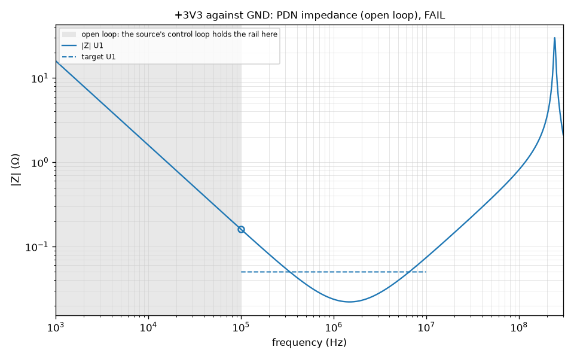

# PDN impedance

A chip's supply has to hold its voltage when the chip's current changes quickly, not only on
average. What decides it is the **impedance** of the power distribution network seen from the
chip's pins, |Z| over frequency: the planes, the decoupling capacitors and the copper between
them. Coppernicus computes it at **probes** you place, against **targets** you set, and says
where it is too high.

<p align="center">
  
</p>

It is the **open-loop** impedance: the regulator is left out of the model, so below its
control-loop bandwidth |Z| keeps rising, where in reality the regulator holds the rail. Nothing
is judged there.

## Set it up

In the project file (the app's **Impedance** tab edits the same):

```yaml
probes:                  # where |Z| is seen: a chip's supply pins against its ground pins
- name: U1
  ref: U1
  net: +3V3
  pins: ['1']
  ground: {net: GND, pins: ['2']}
  target_ohm: 0.05       # 50 mΩ ...
  target_hz: 10000000.0  # ... up to 10 MHz
capacitors:              # the decoupling, by model
- name: 10u
  capacitance_f: 1.0e-05
  esl_h: 5.0e-10
  esr_ohm: 0.02
  refs: [C1]
ac:
  bandwidth_hz:
    U1: 100000.0         # the source's control-loop bandwidth: judged above it only
```

- **Probes**: a part's pins on the rail and its ground pins. The target is a flat `target_ohm`
  up to `target_hz`, a mask (`target_points`, [[Hz, Ω], …], judged only between its first and
  last points), or computed from the chip's `ac_tolerance_v`, `step_a` and `slew_a_per_us`.
- **Capacitors**: ESR + jω·ESL + 1/(jω·C) per model, on the parts listed. A capacitor between
  the rail and ground without a model moves the resonances: its probe is not judged.
- **`ac:`**: the source's bandwidth, the sweep (`f_start_hz`, `f_stop_hz`, `points_per_decade`,
  `field_points_per_decade`), the AC mesh (`max_edge_mm`), the dielectric loss and a link's
  inductance. Without a bandwidth, 50 kHz is assumed and nothing is judged.

The full list of keys is in
[engine-mapping.md](engine-mapping.md#task-9-ac-pdn-impedance-zf--kipiac-kipiacsolversweeppy-kipiacmodelpy).

## Run it

- **App:** the **Impedance** tab: pick the probe's supply and ground pins, the capacitors and
  their models, then **Solve impedance** (Ctrl+I). **Export CSV and PNG…** saves the results.
  The models given in [KiCad footprint fields](kicad-fields.md#capacitor-models) follow the
  project's in the **Capacitor models** table, grey and read-only: they are what the solve
  uses, each cell's tooltip names the field and the part that hold its value, and they are
  never written into the project file. A project model that names a part with such a model
  loses that part to it (marked on its **Parts**, with a line under the table), unless the
  model sets `override_board_fields: true` in the project file. A tolerance changes no |Z|:
  after an edit in the **Tolerance** tab the result stays, and the warning that a load's AC
  tolerance and its probe's `ac_tolerance_v` disagree is the one for the values now.
- **Command line:** `coppernicus ac PROJECT` solves every rail with a probe (`--rail NET` for
  some), writes a CSV and a PNG of |Z|(f) per rail and `<project>_ac_summary.json` into `--out`
  (default `results/` next to the project), and `--html` an offline page (see
  [HTML report](html-report.md#the-impedance-page)). Try `examples/pdn/pdn.coppernicus.yml`.
- **Agents:** the MCP tool `solve_ac` (see [Agents](agents.md#ac-impedance)).
- **CI:** the Action's `ac` input, off by default (see [CI](ci.md)).

It is heavy: minutes and gigabytes on a large board. Before each rail, Coppernicus says what it
will cost, from the same estimate the app shows:

```text
Impedance of +3V3: 20,587 triangles × 2 ports, the copper solved at 111 frequencies: no earlier solve on this computer to time it from. About 20,587 unknowns: one factorization, with the mesh and the model, needs up to 0.276 GB of this machine's ...
```

A coarser AC mesh (`ac: max_edge_mm`) lowers the memory and the time; fewer copper solves per
decade (`field_points_per_decade`) lower the time. An agent's
call that could exceed the memory is refused (`solve_too_large`) until confirmed.

## Reading the results

On the pdn example:

```text
Rail +3V3 against GND: source U1, bandwidth 100 kHz
  solved in 8.7 s: 20,587 triangles, 19,784 unknowns, 2 ports (superlu); sweep 1 kHz to 300 MHz, 1370 points, copper solved at 111
  plane capacitance 0.4975 nF; capacitors modelled 1, without a model 0; links none
  probe U1: |Z| 22.01 mΩ to 29.47 Ω; worst 159.8 mΩ at 100.1 kHz (3.2× target)  FAIL
Verdict: fail. Fail: U1 on +3V3 (target_ohm): |Z| 159.8 mΩ at 100.1 kHz, above the target 50 mΩ there (3.2× it)
```

The worst point is where |Z| divided by the target is highest, where the target applies. Here
it sits right at the bandwidth, 100 kHz: the one 10 µF capacitor does not bring |Z| under 50 mΩ
until 338 kHz (from the CSV). Its minimum, 22 mΩ, is at 1.49 MHz; the resonance at 243 MHz
(29.5 Ω) lies above the 10 MHz target, so it is not judged. The plot
greys the band below the bandwidth, and dashes the target where it applies.

## Verdicts

Only your targets judge.

- **Fail** when |Z| is above the target anywhere it applies, above the bandwidth.
- **Not judged** when no bandwidth is given (50 kHz assumed), a capacitor between the rail and
  ground has no model, the dielectric was assumed, or the sweep does not cover where the target
  applies (the reason says which end of the sweep to move).
- **Pass** otherwise; a probe without a target is ranked, not judged.

`coppernicus ac` exits 0, 1 when a target is exceeded, 3 when a target could not judge, 2 on an
error. The full rules are in
[engine-mapping.md](engine-mapping.md#verdicts-only-against-the-users-target).

## Documentation

- [Power tree](power-tree.md): regulators, ground return, groups and verdicts.
- [Board temperature](thermal.md): the electro-thermal solve of the power tree.
- [PDN impedance](ac-impedance.md): |Z|(f) at the probes, against your targets.
- [Ripple and coupled noise](noise.md): a switcher's ripple and the noise in victim nets, against your margins.
- [Tolerance stack-up](tolerance.md): each load's DC drop, accuracy, ripple and transient, against your tolerances.
- [KiCad footprint fields](kicad-fields.md): the power data on the parts, in KiCad.
- [What-if and compare](what-if-and-compare.md): copper thickness, Pin as baseline, revisions.
- [HTML report](html-report.md): the offline pages of a solve, the power tree, the impedance, the noise and the tolerance stack-up.
- [CI](ci.md): the GitHub Action for KiCad repositories.
- [Agents](agents.md): the MCP server and the `--json` command line for AI agents.
