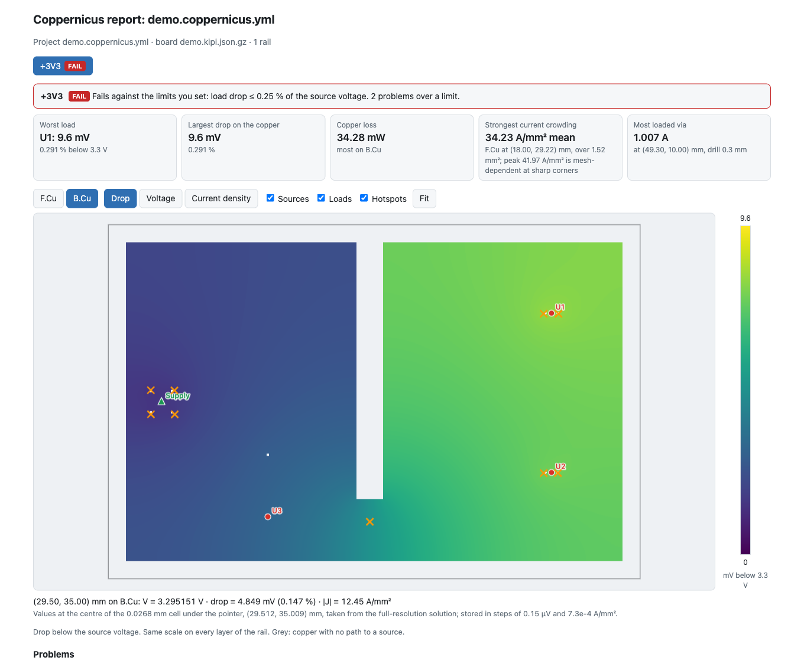

# Coppernicus for AI agents

Coppernicus can be driven by an AI agent (Claude Code, Claude Desktop or any MCP client) that
runs the same DC analyses as the app and reasons about the results. There are two ways in:

- **The MCP server** (`coppernicus mcp`). This is the main way. Boards and results stay in
  memory between calls and maps come back as images.
- **The command line with `--json`.** This is the fallback for an agent that only has a shell.

Both go through the same service layer (`src/coppernicus/service/`) and return the same data.

The Claude Code skill [`skills/analyzing-pdn-with-coppernicus`](../skills/analyzing-pdn-with-coppernicus/SKILL.md)
teaches an agent the workflow and the rules (no invented limits, mean |J| rather than peaks).
Install it with `cp -r skills/analyzing-pdn-with-coppernicus ~/.claude/skills/`.

## Register the server

The server speaks MCP over stdio. It opens no network port. Use absolute paths everywhere,
because a host starts the server from its own working directory.

**Claude Code.** `-s user` makes the server available in every project:

```sh
claude mcp add -s user coppernicus -- \
  uv run --project /absolute/path/to/Coppernicus coppernicus mcp --out /absolute/path/to/coppernicus-maps
```

Run `/mcp` in a Claude Code session to check that `coppernicus` is connected and lists its
tools.

**Claude Desktop.** Add an entry to `claude_desktop_config.json`, then fully quit Claude Desktop
and reopen it. The file is in `~/Library/Application Support/Claude/` on macOS and in
`%APPDATA%\Claude\` on Windows. Claude Desktop starts servers with a minimal `PATH`, so give the
absolute path to `uv` (from `which uv`):

```json
{
  "mcpServers": {
    "coppernicus": {
      "command": "/absolute/path/to/uv",
      "args": ["run", "--project", "/absolute/path/to/Coppernicus", "coppernicus", "mcp",
               "--out", "/absolute/path/to/coppernicus-maps"]
    }
  }
}
```

**Options of `coppernicus mcp`:**

| Option | Default | Meaning |
|---|---|---|
| `--out DIR` | a new folder under the system temp directory | Where maps are written, in one `session-YYYYMMDD-HHMMSS-PID` subfolder per server run. Maps never go next to a board. |
| `--log-file FILE` | stderr | The server log. Nothing is ever written to stdout, which carries the protocol. |
| `--log-level` | `INFO` | `DEBUG`, `INFO`, `WARNING` or `ERROR`. |
| `--max-results N` | 8 | How many solved results keep their fields (meshes, voltages, current density) in memory. |
| `--max-result-mb MB` | 2048 | Memory bound for those fields. |

To check the launch command by hand, run it in a terminal. It should print nothing and wait
for a client on stdin; stop it with Ctrl-C.

## Tools

These are the tools that `src/coppernicus/mcp_server.py` registers. `?` marks an optional
input.

| Tool | Inputs | What it returns |
|---|---|---|
| `open_board` | `path` | Opens a board read-only. Returns `board_id`, copper layers with thickness, counts, the outline bounding box and import warnings. Reopening an unchanged file returns the same `board_id`. |
| `list_nets` | `board_id`, `kind`?, `filter`?, `limit`? | Nets with their kind (`power_or_ground` by default, or `power`, `ground`, `signal`, `all`) and their copper layers: `layers` (all touched), `layers_with_copper` (tracks or zones) and `layers_with_only_vias_or_pads`. Through vias touch every layer, so `layers_with_copper` is the guide to where a rail runs. `filter` is a case-insensitive substring, or a glob over whole names such as `+3V*`. |
| `net_parts` | `board_id`, `net` | Parts on the net with value, footprint and pins, used to choose sources and loads. Also the net ties that join the net to others, which are solved as shorts. |
| `solve_rail` | `board_id`, `net`, `sources`, `loads`, `limits`?, `settings`?, `follow_net_ties`?, `top`? | Solves one rail. A source is `{ref, voltage_v, pins?, name?}`; a load is `{ref, current_a, pins?, name?}`. Returns `result_id` and a summary: load voltages and drops, max drop, loss per layer, busiest layer, top problems, verdict. |
| `get_problems` | `result_id`, `limits`?, `top`? | Ranked problems: loads by drop, current-crowding spots by mean \|J\|, vias by current. Each has a layer and x/y in mm. Pass `limits` to re-judge without solving again. |
| `render_map` | `result_id`, `layer`?, `field`?, `region_mm`?, `dpi`? | A map of `drop` (mV), `voltage` (V) or `current` (A/mm²) on one layer. It comes back as an image and as a PNG file whose path is returned. The default layer is the one with the most copper loss. `region_mm = [x_min, y_min, x_max, y_max]` zooms. |
| `probe` | `result_id`, `layer`, `x_mm`, `y_mm` | Voltage, drop and current density (magnitude and vector) at a point. Off copper, it says which layers have copper there and where the nearest copper is. |
| `cut_current` | `result_id`, `layer`, `x1_mm`, `y1_mm`, `x2_mm`, `y2_mm` | A cross-section along a segment: the copper width crossed, the current through it (∫ J·n t ds, signed along `normal`), and the mean and max \|J\|. Use it to measure a neck. |
| `compare_results` | `result_a`, `result_b` | What-if deltas b − a: settings changed, max drop, loss, drop per load, loss per layer, and both verdicts. |
| `solve_project` | `project_path`, `rails`?, `top`? | Solves the rails of a `*.coppernicus.yml` project with its own sources, loads, limits and settings. Returns one `solve_rail` summary per rail and an overall verdict. A rail that fails to solve is reported in place. A rail with no loads, such as one that only feeds a regulator's input in a power tree, is reported as `skipped`; that is not an error, and it is left out of the verdict. |
| `report` | `result_ids`?, `path`? | Writes the offline HTML report (see [below](#html-report)) of the given results, by default every result still in memory, and returns its path, size and cell sizes. It is meant for a person to open in a browser. |

A summary's `problems` list is complete: every load, then the `top` current-crowding spots and
the `top` vias by current (default 5 each), plus any that exceed a limit you set. Vias carrying
under a millionth of the rail current are left out. That current is solver round-off, and
leaving them out is not a judgement.

On a **ground rail**, which is solved with the source at 0 V, `v_ref_v` is 0. A percentage has
no meaning there: `max_drop_pct` and `drop_pct` are `null`. Give the drops in mV.

`solve_rail` settings, all optional:
- `max_edge_mm`: the largest mesh edge on planes (default 0.5).
- `via_plating_um`: plating for every plated hole. The default is the engine's table by hole
  type.
- `copper_temp_c`: copper temperature for ρ(T) (default 20).
- `copper_thickness_mm`: an optional what-if thickness per copper layer name, in mm, for
  example `{"B.Cu": 0.07}` (1 oz copper is 0.035, not 35). The board file is not changed: a
  real change of copper weight is made in KiCad, which then becomes the board that is solved.
  An unknown layer name is an error (`layer_not_found`) whose message lists the board's copper
  layers.

  A project file can hold the same setting under `settings:` (see
  [Project files](#copper-thickness-in-project-files)). The `solve_rail` tool has no project,
  so it uses only the thicknesses you pass. An in-process caller that passes a project's
  settings as `base_settings` gets them merged layer by layer: a layer you name overrides the
  project's, and the other layers keep the project's value.

  The stack is rebuilt around the new thickness, so via barrels get longer when the stack
  thickens (shorter when it thins). Even a net with no copper on the changed layer then moves
  slightly through its vias. The result's assumptions say which layers were overridden, with
  the board file's value next to each.

Limits, all optional:
- `max_drop_pct`: the largest allowed load drop, in % of the source voltage;
- `max_current_density_a_mm2`;
- `max_via_current_a`;
- `max_ground_rise_mv`: for a ground net solved on its own (a 0 V source at the reference
  point, its return pins as loads), the largest allowed rise of its copper above the source,
  in mV. A single-rail solve judges it on any net it is set on. In the power tree
  (`coppernicus solve --tree`) it judges ground groups only, and is ignored on a supply rail.

Problem kinds, in `problems` of every summary and of `get_problems`:
- `load`: a load's drop at its worst pin (`drop_mv`, `drop_pct`);
- `hotspot`: a current-crowding spot (`mean_j_a_mm2`, `peak_j_a_mm2`, `area_mm2`);
- `via`: a via or plated hole by barrel current (`current_a`);
- `rise`: only with `max_ground_rise_mv` set, the copper furthest from the source voltage
  (`rise_mv`, `limit_mv`), with its layer and x/y;
- `return`: in a power-tree ground group, one ground return pin and its rise above 0 V
  (`rise_mv`, `current_a`), judged against `max_ground_rise_mv`.

## Conventions

- **Units are in every key name:** `_v`, `_mv`, `_a`, `_a_mm2`, `_mm`, `_mm2`, `_w`, `_pct`,
  `_um`, `_c`. Inputs follow the same rule (`voltage_v`, `current_a`).
- **Ids.** Boards are `b1`, `b2`, … and results are `r1`, `r2`, …. Ids are valid for the life
  of one server process and restart with every run.
- **Coordinates** are mm in KiCad's frame: x to the right, **y down**. Layer names are as in
  KiCad (`F.Cu`, `In1.Cu`, `B.Cu`).
- **Errors** are tool errors whose text is `{"error": {"code", "message", "hint"}}`. The hint
  says what to do. For example, `part_not_on_net` lists the parts on the net and
  `pin_not_on_net` lists the pins of the part. Codes: `file_not_found`, `board_unreadable`,
  `board_not_open`, `invalid_project`, `invalid_input`, `net_not_found`, `part_not_on_net`,
  `pin_not_on_net`, `missing_source`, `missing_load`, `layer_not_found`, `result_not_found`,
  `result_evicted`, `cut_misses_copper`, `solve_failed`, `cancelled`, `internal_error`. An
  argument of the wrong type is rejected by the tool's input schema before it runs.
- **Verdicts.** A verdict exists only against limits the user gives:
  - `fail`: a limit you set is exceeded;
  - `pass`: limits are set and none is exceeded;
  - `not_judged`: no limits are set, so problems are ranked and nothing is judged.

  Coppernicus invents no thresholds, and an agent should not either.
- **`assumptions` and `warnings` come with every answer.** Read them. They say:
  - the via plating, ρ(T) and mesh that were used;
  - that loads split their current equally across their pins;
  - that a rail solve does not include the ground return;
  - that point maxima of |J| at sharp corners depend on the mesh;
  - whether the board file changed on disk since it was opened.
- **Progress.** `solve_rail` and `solve_project` send MCP progress notifications with the
  engine's messages. Cancelling the call stops the solve.

## A typical session, on the demo board

`examples/demo/demo.kipi.json.gz` is a synthetic 60 × 40 mm two-layer board. A B.Cu plane is
fed from J1 on the left, and a slot from the top edge (x 28–31 mm, down to y = 31 mm) squeezes
the plane into a neck. U1 and U2 sit beyond the slot; U3 hangs off a thin F.Cu track. Suppose
the user asks: *"U1 draws 2 A, U2 1.5 A, U3 0.3 A from the 3.3 V supply J1. Does it meet a
0.25 % drop budget?"*

1. `open_board(path="/abs/…/examples/demo/demo.kipi.json.gz")` returns `board_id: "b1"`,
   layers F.Cu and B.Cu (0.035 mm each), and `outline_bbox_mm: [0, 0, 60, 40]`.
2. `list_nets(board_id="b1")` returns `+3V3`, a power net on F.Cu and B.Cu.
3. `net_parts(board_id="b1", net="+3V3")` returns J1 (value `SUPPLY`) and U1, U2, U3 (`LOAD`),
   each with pin `1`.
4. Solve the rail:

   ```
   solve_rail(board_id="b1", net="+3V3",
              sources=[{"ref": "J1", "voltage_v": 3.3}],
              loads=[{"ref": "U1", "current_a": 2.0}, {"ref": "U2", "current_a": 1.5},
                     {"ref": "U3", "current_a": 0.3}],
              limits={"max_drop_pct": 0.25})
   ```

   It returns `result_id: "r1"`, `verdict: "fail"` and `busiest_layer: "B.Cu"`. The loads:

   | Load | Drop | Drop % | Exceeds 0.25 %? |
   |---|---|---|---|
   | U1 | 9.60 mV | 0.291 % | yes |
   | U2 | 8.67 mV | 0.263 % | yes |
   | U3 | 6.88 mV | 0.209 % | no |
5. `get_problems(result_id="r1", top=10)` lists the two failing loads first, then the
   current-crowding spots and the most loaded vias. On B.Cu the broadest spot (about 49 mm²) is
   at x ≈ 29.5 mm, y ≈ 33.6 mm: the neck below the slot.
6. `render_map(result_id="r1", field="drop")` and
   `render_map(result_id="r1", field="current")` show the busiest layer by default.
   `region_mm=[20, 25, 40, 40]` zooms on the neck.
7. Probe a point and cut across the neck:
   - `probe(result_id="r1", layer="B.Cu", x_mm=29.5, y_mm=35)` gives V, drop and |J| in the
     neck.
   - `cut_current(result_id="r1", layer="B.Cu", x1_mm=29.5, y1_mm=0, x2_mm=29.5, y2_mm=40)`
     cuts top to bottom through the neck. It returns `width_mm: 7.0` (y 31–38) and
     `current_a ≈ −3.51`, that is U1 + U2 = 3.5 A to within the mesh error. The sign is
     negative because the current flows toward +x, against this cut's `normal` of [−1, 0].
     The mean |J| is about 14.3 A/mm².
8. What-if: solve again with `settings={"copper_thickness_mm": {"B.Cu": 0.07}}`, which gives
   `r2`. Then `compare_results(result_a="r1", result_b="r2")` shows:
   - max drop 9.60 → 6.30 mV;
   - B.Cu loss halved;
   - `verdict_b: "pass"`.

Conclusion for the user: with 1 oz copper the 0.25 % budget fails at U1 and U2. The neck
carries all 3.5 A of the far loads. 2 oz on B.Cu would meet the budget, or the slot could be
shortened; that second option needs a board edit, which is not modelled here.

`tests/test_mcp.py` runs steps 1 to 7 (all but the probe) as an automated test through the
SDK's own client (`test_acceptance_an_agent_reproduces_the_demo_analysis`). It finds the neck
from the broadest hotspot, as above, and checks the 7 mm width and the 3.5 A current.

To hand the result to the person, call `report()` (or `report(result_ids=["r1", "r2"])` to put
the what-if next to the original) and give them the path.

## HTML report

<p align="center">
  
</p>

`coppernicus solve PROJECT --html` (or the MCP `report` tool) writes one self-contained HTML
file. It needs no network and no installed software beyond a current browser (Chrome, Edge,
Firefox or Safari). It holds:

- every rail and every copper layer, as voltage drop, voltage or current density, with zoom
  (wheel), pan (drag) and a **hover readout** of V, drop and |J|;
- toggles for sources, loads and current-crowding spots;
- the verdict, which names the limits you set ("not judged" when there are none), and a
  worst-values summary per rail: worst load, largest drop, copper loss, strongest current
  crowding, most loaded via;
- the problems table (click a row to zoom to it), the loads and sources, the loss per layer,
  the settings, the assumptions and the warnings.

**How the maps are stored.** A large board's mesh is too big to embed, so each layer is sampled
on square cells:
- the voltage at each cell centre is interpolated in the full-resolution triangle that holds
  it, and |J| is that triangle's value;
- both are kept to 16 bits and compressed.

The readout gives the values **at the centre of the cell under the pointer**, says so, and
states the cell size and the storage step. It never interpolates between cells. Summary
numbers and problems come from the full mesh. A browser check on the demo matched the Python
probe at three points, to 1 µV and to the |J| step.

The cell size is chosen per report to stay under a file-size budget (about 27 MB, so at most
about 30 MB), and never finer than a sixth of the median mesh edge. Measured on a synthetic
4-layer board with 3.07 M triangles (80 × 60 mm planes):
- cells of 0.032 mm, 2498 × 1874 per layer;
- a 19.7 MB file, written in 5–7 s;
- in the Chromium that Playwright drives on an Apple-silicon Mac, with the page served from
  localhost:
  - the first map was up at most 0.16 s after navigation started (an upper bound);
  - each further layer decodes in about 45 ms;
  - the page holds about 190 MB of JavaScript memory after every layer has been shown.

These numbers come from smooth synthetic planes. Real boards, with more edges and holes,
compress less well, and their sizes have not been measured yet. If a page would pass 30 MB,
`write_report` and the `report` tool coarsen the cells and rebuild it. The rail-by-rail
`solve --html` path warns instead.

The demo board's report is 2.2 MB, with 0.027 mm cells.

Paths: `--html` alone writes `<out>/<project>_report.html`, where `<out>` defaults to
`results/` next to the project file. `--html PATH` writes it elsewhere, and `--open` also opens
it in the default browser.

## Without MCP: the CLI with `--json`

`nets`, `parts` and `solve` take `--json`. Each prints one JSON document on stdout (the same
data as the tools) and nothing else; progress from `-v` goes to stderr.

```sh
uv run coppernicus nets board.kicad_pcb --json [--all]
uv run coppernicus parts board.kicad_pcb +3V3 --json
uv run coppernicus solve project.coppernicus.yml --out results --json [--rail NET] [--no-maps] \
  [--top N] [--html [PATH]] [--open]
```

`--top N` sets how many current-crowding spots and vias are listed per rail (default 5 each;
every load is always listed).

Exit codes:

| Code | Meaning |
|---|---|
| 0 | Done, and no limit you set was exceeded. |
| 1 | `solve` only: a limit you set was exceeded on some rail. |
| 2 | Error, including a crash (a bug: code `internal_error`). stdout holds `{"error": {"code", "message", "hint"}}` with `--json`, and stderr a one-line message. A crash never exits 1. |

`solve` writes the PNG maps and `<project>_summary.json` to `--out`, with or without `--json`.
The summary file **is** the document that `--json` prints, unit-keyed like the MCP tools. Its
path is in the document's `summary_file`, and the HTML report's path, when one is written, is
in `report_file`.

In CI, the GitHub Action (see [docs/ci.md](ci.md)) runs the same `solve --json --html` on every
project file of a KiCad repository. It writes a job summary and fails on an exceeded limit.

### Copper thickness in project files

A project file can hold an optional what-if copper thickness, in mm, per copper layer name:

```yaml
settings:
  max_edge_mm: 0.5
  via_plating_um: null
  copper_temp_c: 20.0
  copper_thickness_mm:
    B.Cu: 0.07
```

Every solve of that project uses it: `coppernicus solve` (with or without `--json` and
`--html`), the MCP `solve_project` tool, the GitHub Action and the desktop app. The board file
is not changed. Real changes of copper weight are made in KiCad. Each rail's assumptions name
the overridden layers, with the board file's value next to each; the HTML report lists the
setting with the others.

- Values are in mm, finite, above 0 and below 10: 1 oz copper is 0.035, not 35. A value such as
  35 makes the project file invalid.
- A layer name the board does not have fails the whole project, with one `layer_not_found`
  error listing the board's copper layers.
- Without the key, the file is read and saved exactly as before.
- The desktop app solves with the setting but has no field for it yet: edit the YAML. The app
  keeps the key when it saves the project.

## Limits of this version

- **Memory.** A large rail's result can take about 1 GB. Only the `--max-results` most recently
  used results, within `--max-result-mb`, keep their fields. An older result keeps its summary,
  so `compare_results` still works on it. Maps, probes and cuts on it return `result_evicted`,
  whose hint says which rail to solve again.
- **DC only, one net at a time.** The ground return is not included; solve the ground net as its
  own rail. The power tree, thermal, AC impedance and DC-DC ripple, which KiPI's engine has, are
  not exposed yet.
- **What-ifs are settings only:** copper thickness, via plating and temperature, in `solve_rail`
  or in a project file. Adding vias or editing copper is a later step; real changes are made in
  KiCad.
- **The HTML report's maps are sampled on cells** (see [HTML report](#html-report)). Features
  smaller than a cell, such as a hole or a very thin track, can look blocky or vanish in the
  map, while the numbers, the problems and the probes stay exact.
- **Sources and loads come from the project file.** Reading them from KiCad footprint fields is
  a proposal only ([docs/kicad-fields-proposal.md](kicad-fields-proposal.md)).
- **Tested** on macOS, with synthetic boards and the SDK's own client (in memory and over stdio).
  Registration in Claude Code and Claude Desktop follows their documented commands but has not
  been run in those hosts yet. Windows runs in CI as an informative job.
