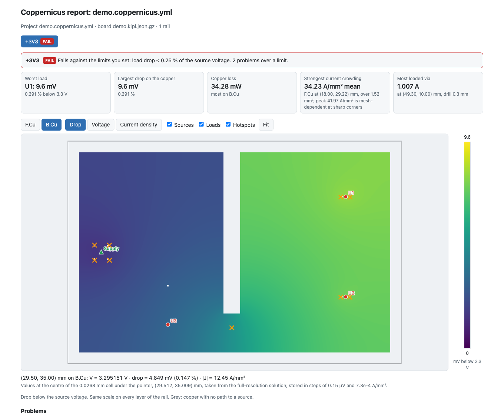
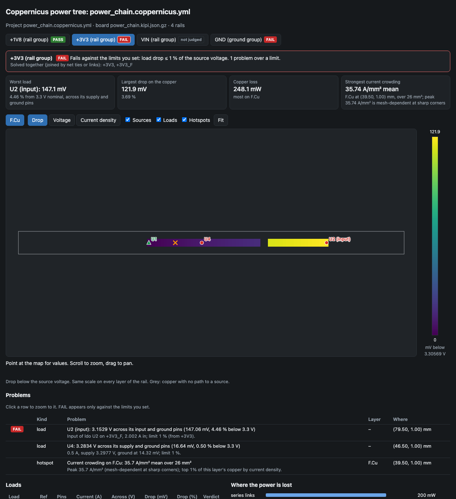
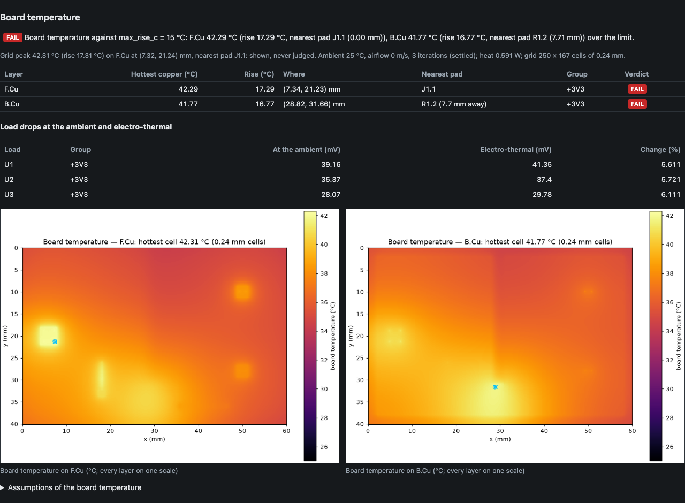
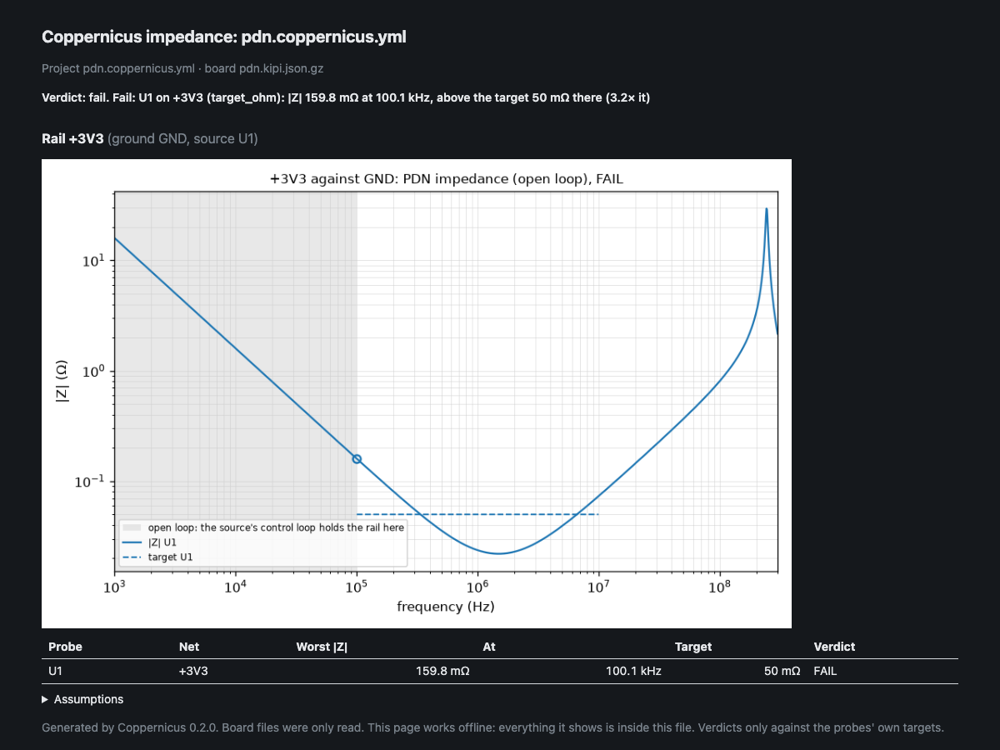

# The HTML report

The report is one HTML file that holds a whole analysis: every solved rail, every copper layer
as a map you can zoom and point at, the problems, the verdict and the assumptions. It needs no
network and no installed software beyond a current browser (Chrome, Edge, Firefox or Safari),
so you can send it to someone who does not have Coppernicus, or attach it to a design review.

  

## Make one

- **App:** **Export report** (Ctrl+R) writes the report of every rail you have solved. The Save
  dialog starts in `results/` next to the project file.
- **Command line:** `coppernicus solve PROJECT --html` writes `<out>/<project>_report.html`
  (`<out>` is `results/` next to the project file unless `--out` says otherwise); `--html PATH`
  writes it elsewhere, and `--open` also opens it in the browser.
- **Power tree:** `coppernicus solve PROJECT --tree --html` writes one page with every group of
  the tree and the tree's tables ([below](#the-power-tree-report)).
- **Impedance:** `coppernicus ac PROJECT --html` writes its own page ([below](#the-impedance-page)).
- **CI:** the GitHub Action attaches the report to every run, in the `coppernicus-results`
  artifact (see [CI](ci.md)).
- **Agents:** the MCP tool `report` writes one page for the results of a session (see
  [Agents](agents.md#html-report)).

Board files are only read; the report goes where you say, never next to a board elsewhere.

## What it holds

For each rail, chosen at the top of the page:

- **The verdict**, which names the limits you set: *PASS*, *FAIL*, or *not judged* when there
  are none, or when a limit could not judge something (it then says what and why).
- **The worst values:** worst load, largest drop on the copper, copper loss and where most of
  it is, the strongest current crowding, the most loaded via.
- **The maps**, one per copper layer: **Drop** (how many mV each point is below the source),
  **Voltage** or **Current density**. Scroll to zoom, drag to pan, **Fit** to see the whole
  board; toggles show or hide the sources, the loads and the crowding spots. Point at the map
  for the voltage, the drop and |J| under the pointer.
- **Problems**, fails first: click a row to zoom to it. *FAIL* appears only against the limits
  you set.
- **Loads and sources**, with each load's voltage at its worst pin, its drop and how it
  compares with the drop limit; **where the power is lost**, per layer, in the vias and in the
  links; the **settings**, the **assumptions** and the **warnings**.

The drop is measured the way the app shows it: below the source voltage on a positive rail,
toward 0 V on a negative one, as a rise above 0 V on a ground, and as a **ground shift** (how
far below 0 V) on a ground under a negative rail. The colour bar names which.

A link ending in `#group=NET`, for example `report.html#group=+3V3`, opens that rail instead of
the first one.

## How the maps are stored

A large board's mesh is too big to put in a page, so each layer is sampled on square cells: the
voltage at each cell centre is taken from the full-resolution triangle that holds it, and |J| is
that triangle's value. Both are kept to 16 bits and compressed.

- The readout gives the values **at the centre of the cell under the pointer**, says so, and
  states the cell size and the storage step. It never interpolates between cells.
- The summary numbers, the problems and the tables come from the full mesh, not from the cells.
- Features smaller than a cell, such as a hole or a very thin track, can look blocky or vanish
  in the map; the numbers stay exact.
- The cell size is chosen per report to keep the file under about 30 MB. The demo board's
  report is about 2 MB.

## The power tree report

`coppernicus solve PROJECT --tree --html` writes one page for the whole [power tree](power-tree.md):
a tab per group (a rail with the nets its links and net ties join, or a ground net), and below
them the tree's own tables: the regulators, the loads with the voltage across their pins, and
the links. Here, the power chain with a 1 % limit on +3V3 and on +1V8 and a 30 mV limit on GND
(limits only for the example), opened on its +3V3 group with `#group=+3V3`:

  

In a group, the **loads table and the worst-load card show what the tree judged**: the voltage
across each load's supply and ground pins (a regulator's input pins, for a regulator the group
feeds), its drop from its nominal voltage, and the tree's verdict, each by its own net's limit.
The **map** is the copper drop below the group's source output, as its scale says: the two
differ by the ground's rise and by the source's own output voltage. Here U2's input is judged
at 147.06 mV (4.46 %) across its pins, against the +3V3 limit of 1 %: *FAIL*.

### Board temperature

When the tree is solved with the [board temperature](thermal.md) (`--thermal`, or a project that
enables it), the page adds a **Board temperature** section: the verdict against your
`max_temp_c` / `max_rise_c`, the grid peak with its nearest pad (shown, never judged), the
hottest solved copper of each layer with its rise and nearest pad, each load's drop at the
ambient and electro-thermal, the assumptions, and each copper layer's temperature map, all on
one scale from the ambient to the peak. The maps are kept inside the page.

  

## The impedance page

`coppernicus ac PROJECT --html [PATH]` writes one page of the [PDN impedance](ac-impedance.md):
the verdict, and for each rail its |Z|(f) plot with the targets and the band below the source's
control-loop bandwidth, its probes with their worst |Z| against their targets, the assumptions
and the warnings. Like the other pages, everything is inside the file.

  

## Documentation

- [Power tree](power-tree.md): regulators, ground return, groups and verdicts.
- [Board temperature](thermal.md): the electro-thermal solve of the power tree.
- [PDN impedance](ac-impedance.md): |Z|(f) at the probes, against your targets.
- [KiCad footprint fields](kicad-fields.md): the power data on the parts, in KiCad.
- [What-if and compare](what-if-and-compare.md): copper thickness, Pin as baseline, revisions.
- [HTML report](html-report.md): the offline pages of a solve, the power tree and the impedance.
- [CI](ci.md): the GitHub Action for KiCad repositories.
- [Agents](agents.md): the MCP server and the `--json` command line for AI agents.
