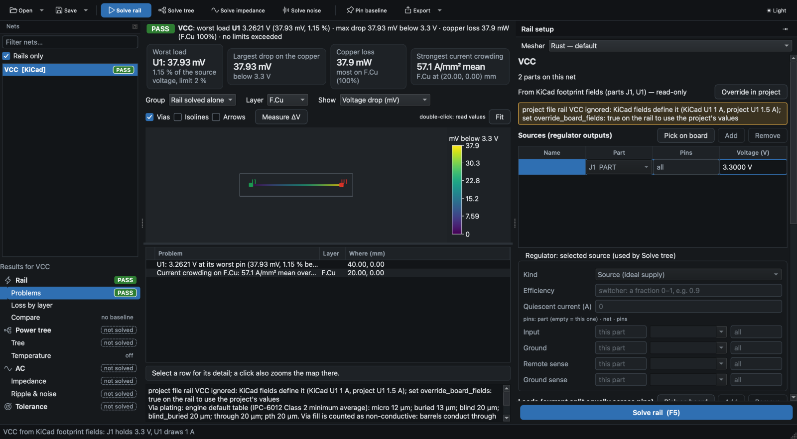
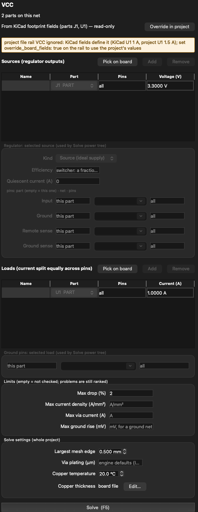

# KiCad footprint fields

A rail's power data belongs to the design: the regulator's output voltage on the regulator,
each chip's current on the chip. Kept in KiCad, it cannot drift away from the board, and a new
board can be checked with an almost empty project file.

Coppernicus reads **fields named `PI_*`** on the parts. You add them to the symbols in the
schematic; KiCad copies a symbol's fields onto its footprint when you update the PCB from the
schematic, so they reach the `.kicad_pcb` file that Coppernicus reads. Coppernicus only reads
them, from `.kicad_pcb` files (ODB++, HyperLynx and snapshots have none), and never writes a
KiCad file.

Try it on the synthetic example `examples/fields`: two parts on the net VCC carry the whole
rail.

```text
$ coppernicus fields examples/fields/fields.kicad_pcb
  J1       PI_RAIL=VCC  PI_SOURCE=3.3V
  U1       PI_RAIL=VCC  PI_LOAD=1A  PI_LIMIT_DROP=2%
Rail VCC
  Rail VCC from KiCad footprint fields (from KiCad field PI_RAIL on J1, U1): source J1 3.3 V (from KiCad field PI_SOURCE "3.3V" on J1), every pin on the net; load U1 1 A (from KiCad field PI_LOAD "1A" on U1), every pin on the net; limit max_drop_pct 2 (from KiCad field PI_LIMIT_DROP "2%" on U1).
```

<p align="center">
  
</p>

## The fields

Every field is optional; a part without `PI_*` fields is not touched.

| Field | Example | On | Meaning |
|---|---|---|---|
| `PI_RAIL` | `+3V3` | source, load | The net the part is a source or load on. Required with every per-rail field below. Several rails: `VIN;+3V3`. |
| `PI_SOURCE` | `3.3V` | source | The part holds the rail at this voltage (a regulator output, a connector). |
| `PI_LOAD` | `2A`, `250mA` | load | The part draws this current, split equally across its pins on the rail. |
| `PI_PINS` | `1,2`, `A*` | source, load | Which pads take part, by number or glob. Default: every pad of the part on the rail. |
| `PI_LIMIT_DROP` | `2%` | source, load | A drop limit for the rail; the strictest one on a rail is used. |
| `PI_KIND` | `ldo` | source | `source` (an ideal supply, the default), `ldo` or `smps`. |
| `PI_EFF` | `90%` | switcher | Its efficiency; required with `PI_KIND` `smps`. |
| `PI_IQ` | `2mA`, `50uA` | regulator | Its quiescent current (`A`, `mA`, `uA` or `µA`). |
| `PI_INPUT` | `VIN` | regulator | The net it draws from (its pads there); required with `ldo` and `smps`. `PI_INPUT_PINS` chooses the pads. |
| `PI_GND` | `GND` | source, load | The ground net of its ground pins, the return path the [power tree](power-tree.md) solves. `PI_GND_PINS` chooses the pads. |
| `PI_LINK` | `50mOhm` | a two-net part | A link (ferrite, sense resistor, fuse) of this resistance between the nets of its pads (`Ohm`, `mOhm`, `Ω`). Not with `PI_RAIL`. |
| `PI_LINK_PINS` | `1,2;5` | a link part with more nets | The link's two sides on a part with more than two nets (a load switch, a MOSFET, a 3-pin fuse): side A's pads `;` side B's, each side on one net. |
| `PI_VOUT` | `3.3V` | source | A fixed-output part's voltage, on its library symbol: the source voltage when the placed part has no `PI_SOURCE`. If both are given and differ, `PI_SOURCE` wins, with a warning. |
| `PI_IMAX` | `2A`, `500mA` | source | Its rated output current: shown next to I out in the power tree, where an I out above it fails ([power tree](power-tree.md#verdicts)). |
| `PI_FSW` | `500kHz`, `2.2MHz` | switcher | Its switching frequency (`Hz`, `kHz`, `MHz`): kept, not used yet. |
| `PI_SOURCE_REF` | `L1`, `BT1,BT5` | source | The part(s) whose pads hold the rail, when not this part: an external-inductor buck's inductor, or several cell holders in parallel, which make **one** terminal, every pad at the source voltage. `PI_PINS` then takes `REF.PAD` entries (`BT1.1,BT5.1`), or a pad for every listed part. |
| `PI_GND_REF` | `BT4` | source, load | The part whose pads are the ground pins on `PI_GND`, when not this part (one part). |

- **Several rails on one part** take one value per rail, by position, separated by `;`, in
  every per-rail field. An empty value skips that rail. A dual-output regulator:
  `PI_RAIL=+3V3;+1V8`, `PI_SOURCE=3.3V;1.8V`, `PI_KIND=smps;ldo`, `PI_EFF=90%;`,
  `PI_INPUT=VIN;+3V3`.
- **Units are required.** A bare number (`2`), a comma (`2,5A`) or a KiCad-style value (`3V3`)
  is refused, and so is an unknown name (`PI_LOADS`, or `pi_load` in lower case). The message
  names the part, the field and its text. A blank field is not set.
- **Nothing is assumed.** A regulator without `PI_INPUT`, a switcher without `PI_EFF`, a net
  with loads and no source anywhere in its group, or a source that feeds nothing is an error
  that names the missing field, unless the project file defines that rail (then the project's
  rail is used, with a warning). A field that cannot be used stops the whole run, and the
  message says how to turn the fields off.
- A regulator draws its input through `PI_INPUT`; a `PI_LOAD` on that same net is refused,
  since it would count the current twice.

**Library fields need no `PI_RAIL`.** `PI_KIND`, `PI_EFF`, `PI_IQ`, `PI_VOUT`, `PI_IMAX` and
`PI_FSW` describe the part itself, so they can sit on a library symbol before it is placed on
any rail: a part with only these is part data, used once its placed symbol gets `PI_RAIL`. One
such value applies to every rail where the part is a source (or give one per rail with `;`). A
part that is a source on no rail but carries them is refused: that is a regulator placed as a
load.

Three shapes need the newer fields:

- **An external-inductor buck:** the IC carries `PI_RAIL`, `PI_SOURCE` (or the library's
  `PI_VOUT`), `PI_INPUT`, `PI_GND` and `PI_KIND`, plus `PI_SOURCE_REF=L1` and `PI_PINS=2`: the
  rail is held at the inductor's output pad.
- **A load switch:** `PI_LINK=20mOhm` and `PI_LINK_PINS=1,2;5` (input pads 1 and 2, output pad 5)
  on a part whose other pads are the enable and the ground.
- **A battery of cell holders:** the holders BT1 and BT5 in parallel, the negative pole BT4. BT1
  carries `PI_RAIL=+V_BAT`, `PI_SOURCE=6.4V`, `PI_SOURCE_REF=BT1,BT5`, `PI_GND=-V_BAT` and
  `PI_GND_REF=BT4`; the other holders carry nothing.

Each worked example, field by field, is in
[Agents → How to annotate a KiCad library](agents.md#how-to-annotate-a-kicad-library).

A net with a `PI_SOURCE` and a `PI_LOAD` is a rail. So is a net whose source feeds a
regulator's input or a link: it draws their current. Loads behind a ferrite (`PI_LINK`) or on
a net joined by a net tie belong to the driven net's group. The details, with every edge case,
are in [Agents → KiCad footprint fields](agents.md#kicad-footprint-fields).

## Where to put them in KiCad

Some fields say what a part **is**, the same on every board; the others say **where it sits**
on this one. The KiCad 9 manual describes the two places:

- **The library symbol** (Symbol Editor): `PI_KIND`, `PI_EFF`, `PI_IQ`, `PI_VOUT`, `PI_IMAX`,
  `PI_FSW`. A symbol placed in the
  schematic takes a copy of the library symbol. Later changes to the library are not applied
  to symbols already placed; **Tools → Update Symbols from Library…** brings them in, with a
  choice of which fields to update.
- **The symbol in the schematic** (its properties, on that one placement): `PI_RAIL`,
  `PI_SOURCE`, `PI_SOURCE_REF`, `PI_LOAD`, `PI_PINS`, `PI_LIMIT_DROP`, `PI_INPUT`,
  `PI_INPUT_PINS`, `PI_GND`, `PI_GND_PINS`, `PI_GND_REF`, `PI_LINK`, `PI_LINK_PINS`. Editing a
  placed symbol changes only that instance, not the library.

Then run **Tools → Update PCB from Schematic…** (F8). In the manual's words, "all symbol
fields will be added to the symbol's corresponding footprint when the PCB is updated from the
schematic". Save the board, and Coppernicus reads the new values: in the app,
**File → Reload board** (Ctrl+Shift+R).

A drop limit that is a chip's own supply tolerance, from its datasheet, belongs to that
chip's library symbol, since it is part of what the chip is.

> The KiCad steps above follow the KiCad 9 manual; they have not been run here on a real
> KiCad project. Check them once on a small test project with your KiCad version.

## With a project file

The fields and a project file work together. The fields give the design data; the project
file gives what fields cannot carry and lets you try something else.

- **KiCad wins.** For a net the fields define, the fields give the sources, loads, pins and
  converter data. A project-file rail of the same net is **ignored**, with a warning that lists
  the differences. The fields example has one on purpose: its project file says U1 draws
  1.5 A, its footprint field says 1 A, and every solve says

  ```text
  warning: project file rail VCC ignored: KiCad fields define it (KiCad U1 1 A, project U1 1.5 A); set override_board_fields: true on the rail to use the project's values
  ```

  A project rail equal to the fields' gives no warning. Pins are compared as the pads they
  select, so `pins: [1]` on a one-pad part equals "every pin".
- **Override.** `override_board_fields: true` on a project rail keeps that rail instead, for a
  what-if; its results say they override the KiCad values. In the app: **Override in
  project**, and **Use KiCad fields** to go back.
- **A KiCad limit always applies.** `PI_LIMIT_DROP` wins over the project's `max_drop_pct`
  (with a warning when they differ), even when the project rail overrides the fields or the
  fields are incomplete. The other limits (current density, via current, ground rise) come
  from the project file: give them on a rail that holds only `limits:`, which is not compared
  with the fields.
- **Project file only:** the solve settings, remote sense (carried over to the fields' rail by
  part), and limits other than the drop.
- **Links:** a `PI_LINK` part replaces a project link on the same part, with a warning when
  they differ.
- **Turning the fields off:** `use_board_fields: false` in the project file,
  `--no-board-fields` on `coppernicus solve`, or **Project → Use KiCad footprint fields** in the
  app.

The fields are read by the app, `coppernicus solve` (with or without `--tree`), the GitHub
Action and the agents' tools.

<p align="center">
  
</p>

In the app, a rail from the fields is listed with a **[KiCad]** mark and shown read-only: its
values are the fields'. Hover a value to see the field it came from.

## Listing and proposing fields

`coppernicus fields BOARD` lists a board's `PI_*` fields and the rails they make, as above
(`--json` for scripts). A rail is listed complete exactly when a solve of the fields alone
would take it, links and the board's net ties included: loads behind a ferrite, or a battery
that only feeds links towards a regulator's input, are complete, and the note says what
completes them ("Complete without a source of its own: link FB1 joins it to +3V3, driven by
U1"). An incomplete rail says what is missing after its name.

`coppernicus fields --propose PROJECT` goes the other way: it prints the fields that describe
a project's rails, part by part, split between the library symbol and the schematic
instance, for you to paste into KiCad. Coppernicus never writes them itself. On the power
chain example:

```text
$ coppernicus fields --propose examples/power_chain/power_chain.coppernicus.yml
FB1
  schematic instance: PI_LINK=50mOhm
J1
  schematic instance: PI_RAIL=VIN  PI_SOURCE=12V  PI_PINS=1  PI_GND=GND  PI_GND_PINS=2
U1
  library symbol:     PI_KIND=smps  PI_EFF=90%  PI_IQ=5mA
  schematic instance: PI_RAIL=+3V3  PI_SOURCE=3.3V  PI_PINS=2  PI_INPUT=VIN  PI_INPUT_PINS=1  PI_GND=GND  PI_GND_PINS=3
U2
  library symbol:     PI_KIND=ldo  PI_IQ=2mA
  schematic instance: PI_RAIL=+1V8  PI_SOURCE=1.8V  PI_PINS=2  PI_INPUT=+3V3_F  PI_INPUT_PINS=1  PI_GND=GND  PI_GND_PINS=3
U3
  schematic instance: PI_RAIL=+1V8  PI_LOAD=2A  PI_PINS=1  PI_GND=GND  PI_GND_PINS=2
U4
  schematic instance: PI_RAIL=+3V3  PI_LOAD=500mA  PI_PINS=1  PI_GND=GND  PI_GND_PINS=2
not expressed (rail +1V8 U2): remote sense (sense, ground_sense): keep it in the project file; fields cannot carry it; it is not proposed
```

The proposal is checked by reading it back: it gives the project's rails again. What fields
cannot carry is listed as *not expressed*: remote sense, terminal names, the limits other than
the drop, `follow_net_ties: false`. A rail that would need input or ground pins on another
part, or a link that does not use all of its part's pads, is not proposed at all, since a
wrong field would stop every run. A rail's `max_drop_pct` becomes `PI_LIMIT_DROP` on its first
source.

Agents get the same through the MCP tools `board_fields` and `propose_fields` (see
[Agents](agents.md#proposing-fields)).

## Documentation

- [Power tree](power-tree.md): regulators, ground return, groups and verdicts.
- [Board temperature](thermal.md): the electro-thermal solve of the power tree.
- [PDN impedance](ac-impedance.md): |Z|(f) at the probes, against your targets.
- [KiCad footprint fields](kicad-fields.md): the power data on the parts, in KiCad.
- [What-if and compare](what-if-and-compare.md): copper thickness, Pin as baseline, revisions.
- [HTML report](html-report.md): the offline pages of a solve, the power tree and the impedance.
- [CI](ci.md): the GitHub Action for KiCad repositories.
- [Agents](agents.md): the MCP server and the `--json` command line for AI agents.
