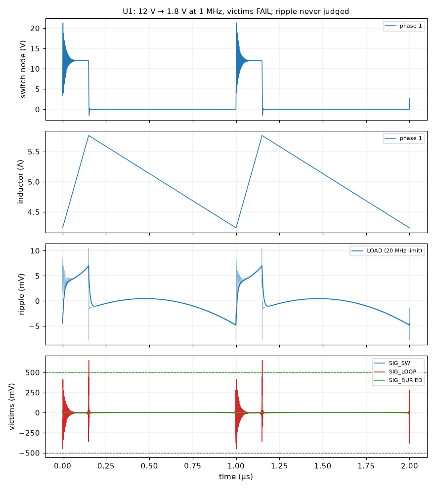
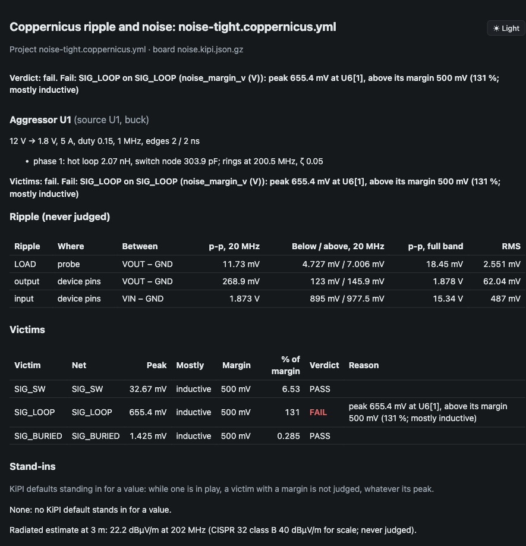

# Ripple and coupled noise

A switching regulator chops its input at a few hundred kHz to a few MHz, with edges of a few
nanoseconds. Two things follow on the board: **ripple** on its input and output rails, and
**noise coupled** into the signal nets that run near its switch node and current loops. A
line that picks up more than its receiver can tolerate flips a logic level or corrupts an
analog reading. Coppernicus computes both from the real copper, for each switcher you mark as an
**aggressor**, at each signal net you mark as a **victim**, and judges a victim only against a
**noise margin** you set.

<p align="center">
  
</p>

What it computes, per aggressor (KiPI's noise solver):

- the **hot loop** of each phase traced through the copper (its inductance, the switch node's
  capacitance, Coss plus copper, and the ringing they make);
- the **waveforms** of one switching period: the switch node, the inductor current, as exact
  Fourier series up to where the edges stop mattering;
- the **ripple** at the regulator's own pins and at the probes you name, from a field model of
  the copper terminated by the capacitors (the board model), full band and through a 20 MHz
  limit as a scope would show it;
- the **near field** 5 mm above the board (H and E maps) and a **radiated estimate** at 3 m,
  with the CISPR 32 class B line for scale;
- for each **victim**, the noise at its receiver: capacitive (from the switch nodes),
  inductive (from the capacitor and inductor loops) and through the shared ground, added as
  phasors, with the line held high and held low.

The method and every key are in
[engine-mapping.md](engine-mapping.md#task-10-dc-dc-ripple-and-coupled-noise--kipinoise-kipinoisesolverpy-kipinoisemodelpy).

## Set it up

In the project file, next to the rails that already hold the regulator as a source
(`kind: smps`) and the capacitor models (`capacitors:`):

```yaml
aggressors:
- name: U1
  vrm: U1                  # the switcher, a source of the project
  fsw_hz: 1000000.0        # else the source's fsw_hz (KiCad field PI_FSW)
  rise_s: 2.0e-09          # 0-100 % edges: they set the spectrum
  fall_s: 2.0e-09
  ripple_probes: [LOAD]    # probes: where else to read the ripple
  phases:
  - inductor: L1
    inductance_h: 1.0e-06
    switch_net: SW
    high_side: {ref: U1, net: VIN, pins: ['1']}
    low_side: {ref: U1, net: GND, pins: ['2']}
    input_caps: [C1]
    output_caps: [C2]
    coss_f: 3.0e-10        # empty: KiPI's 200 pF stands in
    qrr_nc: 5.0            # empty: KiPI's 5 nC stands in (0 for a Schottky or GaN low side)
victims:
- net: SIG_LOOP
  preset: cmos             # cmos, open_drain, series, parallel, lvds, analog, hiz, or custom
  driver: {ref: U5, pins: ['1']}
  receiver: {ref: U6, pins: ['1']}
  logic_v: 3.3             # on KiPI's JESD8 table: its levels give the margin
  noise_margin_v: 0.5      # or a margin of your own, which wins
noise:                     # optional; KiPI's defaults otherwise
  board_model: true
  field_per_decade: 10
```

- **Aggressor**: the regulator (`vrm`), its switching frequency and edges, and one entry per
  phase: the inductor, the switch net, the switching device's high-side and low-side pins, and
  the input and output capacitors that close its hot loop.
- **Victim**: a net, its type (`preset`), its driver and receiver pins, and a margin: your
  `noise_margin_v`, else the preset's own (lvds 0.1 V, analog 0.01 V), else the JESD8 levels of
  an entered `logic_v` (0.8 V for 3.3 V logic). Without any, the victim is ranked, not judged.
- **`noise:`**: the harmonics (`f_max_hz`, `max_harmonics`), the dead time, the victims'
  cross-section steps (`segment_mm`, `window_mm`), the board model on or off and its field
  solves per decade (`field_per_decade`). The AC mesh is the project's `ac: max_edge_mm`.

## Run it

- **App:** the **Ripple & noise** tab edits the same: add an aggressor (its source, switching
  frequency and edges), **Fill from board** for its phases, add the victims (**Guess ends**,
  then enter them), then **Solve noise** (Ctrl+Shift+N). **Export…** saves each aggressor's
  CSV and PNGs and the summary, named as the command line names them.
- **Command line:** `coppernicus noise PROJECT` solves every aggressor (`--aggressor NAME` for
  some) and writes, per aggressor, a CSV of one period, the waveforms PNG and the H and E
  field-map PNGs, and `<project>_noise_summary.json` into `--out` (default `results/` next to the
  project); `--json` prints that document, and `--html` writes an offline page (see
  [HTML report](html-report.md#the-noise-page)). Try `examples/noise/noise.coppernicus.yml`
  (passes) and `noise-tight.coppernicus.yml` (fails).
- **Agents:** the MCP tool `solve_noise` (see [Agents](agents.md#ripple-and-coupled-noise)).
- **CI:** the Action's `noise` input, off by default (see [CI](ci.md)).

It is heavy: minutes and gigabytes on a large board. Before each aggressor, Coppernicus says
what it will cost, from the same estimate the app shows: it checks the setup and meshes the
board model as the solve will, then gives the mesh, the ports, the field solves, the harmonics
and the whole solve's memory against this machine's:

```text
Noise of U1: 15,534 triangles × 8 ports, the copper solved at 34 frequencies: no earlier solve on this computer to time it from; 1592 harmonics to 1.592 GHz. About 14,757 unknowns: the noise solve may peak at up to 0.731 GB of this machine's ...
```

The memory figure is an upper bound measured on synthetic boards; a real board's copper may
need less. A coarser AC mesh (`ac: max_edge_mm`) or fewer field solves (`noise:
field_per_decade`) lower it. The command line only warns, and the app asks before it goes on;
an agent's call that could exceed the memory is refused (`solve_too_large`) until the user
confirms.

## Reading the results

On `examples/noise/noise-tight.coppernicus.yml` (a 0.5 V margin on every victim):

```text
Aggressor U1 (source U1, buck): 12 V → 1.8 V, 5 A, duty 0.15, 1 MHz, edges 2 / 2 ns
  phase 1: hot loop 2.07 nH, switch node 303.9 pF; rings at 200.5 MHz, ζ 0.05
  ripple LOAD (probe, VOUT − GND): 11.73 mV p-p at 20 MHz (4.727 mV below, 7.006 mV above), full band 18.45 mV p-p; not judged
  victim SIG_SW on SIG_SW: peak 32.67 mV (mostly inductive), margin 500 mV (6.53 %)  PASS
  victim SIG_LOOP on SIG_LOOP: peak 655.4 mV (mostly inductive), margin 500 mV (131 %)  FAIL
  victim SIG_BURIED on SIG_BURIED: peak 1.425 mV (mostly inductive), margin 500 mV (0.285 %)  PASS
  radiated estimate at 3 m: 22.2 dBµV/m at 202 MHz, CISPR 32 class B 40 dBµV/m (for scale, not judged)
Verdict: fail. Fail: SIG_LOOP on SIG_LOOP (noise_margin_v (V)): peak 655.4 mV at U6[1], above its margin 500 mV (131 %; mostly inductive)
```

SIG_LOOP runs beside the hot loop's VIN track: its 655 mV is mostly inductive, and above the
0.5 V margin. In `noise.coppernicus.yml` the same line has only `logic_v: 3.3`, whose JESD8
margin is 0.8 V: 82 % of it, a pass. SIG_BURIED runs under it on an inner layer, behind the
ground plane, and picks up 1.4 mV. The ripple and the radiated estimate are printed, never
judged.

<p align="center">
  
</p>

## Verdicts

Only your margins judge.

- **Fail** when a victim's peak at its receiver is above its margin.
- **Not judged** while a **stand-in** is in play: a KiPI default standing in for a value
  you did not give, or a part of the coupling left out. Then the peak is reported with its
  share of the margin, but the victim is not passed, whatever its size. The stand-ins:
  - Coss or Qrr not entered on a phase (KiPI's 200 pF and 5 nC);
  - a capacitor on the converter's rails without a model;
  - an assumed dielectric constant;
  - a phase without a switch net (no capacitive coupling from it);
  - a listed capacitor for which no current loop could be drawn (the reason names the pad or
    pin that is missing);
  - harmonics cut short (`max_harmonics`, a low `f_max_hz`, or KiPI's 3 GHz ceiling);
  - the board model off or left out (no shared-ground coupling);
  - for one victim: its driver and receiver guessed, a coupling left out for it (no capacitor
    loops, no tracks, no ground pad at its ends, pins off the board), or its line already past
    its threshold when idle.

  A `logic_v` that is not on KiPI's JESD8 table gives no margin: not judged, with "enter
  noise_margin_v", never a silent pass.
- **Pass** when every victim with a margin stays within it and nothing stands in.
- A victim without a margin is ranked, not judged; with no margin at all, nothing is judged
  (exit 0).

**Never judged:** the ripple (it depends on the load's own tolerance, which a later analysis
stacks per load), the near field and the radiated estimate (an indicator, with CISPR 32 class B
for scale, not a compliance result). Coppernicus invents no margin.

`coppernicus noise` exits 0, 1 when a margin is exceeded, 3 when a margin could not judge
(a stand-in, or an off-table `logic_v`), 2 on an error. The full rules are in
[engine-mapping.md](engine-mapping.md#verdicts-brief-q2-q4-only-the-users-margins).

## Documentation

- [Power tree](power-tree.md): regulators, ground return, groups and verdicts.
- [Board temperature](thermal.md): the electro-thermal solve of the power tree.
- [PDN impedance](ac-impedance.md): |Z|(f) at the probes, against your targets.
- [Ripple and coupled noise](noise.md): a switcher's ripple and the noise in victim nets, against your margins.
- [KiCad footprint fields](kicad-fields.md): the power data on the parts, in KiCad.
- [What-if and compare](what-if-and-compare.md): copper thickness, Pin as baseline, revisions.
- [HTML report](html-report.md): the offline pages of a solve, the power tree, the impedance and the noise.
- [CI](ci.md): the GitHub Action for KiCad repositories.
- [Agents](agents.md): the MCP server and the `--json` command line for AI agents.
