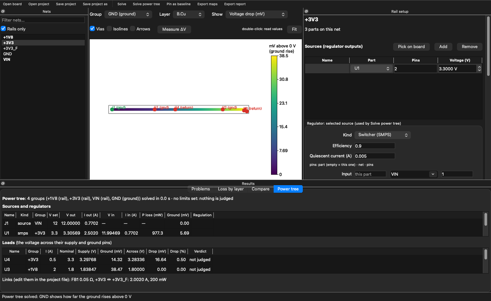
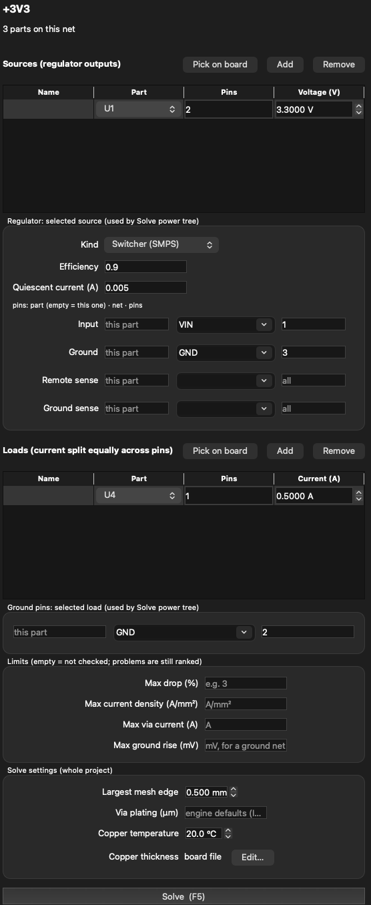
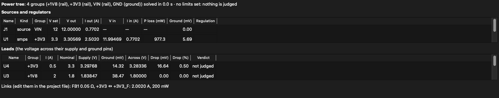

# The power tree

One rail at a time is the quick check. On a real board the rails feed each other: a 12 V
input feeds a switcher, the switcher's 3.3 V feeds an LDO through a ferrite, and every return
current flows back through the same ground copper. The **power tree** solves all of it in one
go:

- every rail and every ground net of the project, together;
- each regulator as a **load on the rail that feeds it**, with its input current computed from
  what its output delivers;
- the **ground return**: the return current flows in the ground copper, so the ground rises
  above 0 V away from the main supply, and a load sees its supply pin minus its ground pin.

Try it on the synthetic example `examples/power_chain/power_chain.coppernicus.yml`: J1 (12 V)
feeds U1, a switcher making 3.3 V; U1 feeds the load U4 and, through the ferrite FB1, the LDO
U2, which makes 1.8 V for U3 with remote sense.

<p align="center">
  
</p>

## Run it

- **App:** open the project, then **Solve power tree** (Ctrl+T). The **Power tree** tab lists
  the regulators, the loads and the links; **Group** shows one rail group or the ground net on
  the board.
- **Command line:** `coppernicus solve PROJECT --tree` prints the tables;
  `--html` also writes one offline page with every group (see [HTML report](html-report.md#the-power-tree-report)).
- **Agents:** the MCP tool `solve_tree(project_path)` returns the same as JSON (see
  [Agents](agents.md#power-tree)).
- **CI:** the GitHub Action's `tree` input adds the tree's tables to the job summary (see
  [CI](ci.md)).

## What the tree needs

The tree reads the same project file as the rail-by-rail solve, with a few more fields. In
the app they are in the **Rail setup** panel: click a regulator under *Sources* and fill the
**Regulator** box; click a load under *Loads* to give its **Ground pins**.

<p align="center">
  
</p>

| What | Where in the project file | Meaning |
|---|---|---|
| Kind | `kind: source`, `ldo` or `smps` | `source` is an ideal supply (a connector, a bench supply). `ldo` and `smps` draw their input current from another rail. |
| Efficiency | `efficiency: 0.9` | A switcher's efficiency, from 0 to 1. Required with `smps`. |
| Quiescent current | `quiescent_a: 0.005` | Drawn from the input on top of the output's share, in A. |
| Input pins | `input: {net: VIN, pins: ['1']}` | Where the regulator draws from. Required with `ldo` and `smps`. |
| Ground pins | `ground: {net: GND, pins: ['3']}` | Where a source or a load returns its current. Needed when the ground net is solved. |
| Remote sense | `sense:` and `ground_sense:` (part, net, pins) | The regulator holds its voltage at the sense pins instead of its own output pins. |
| Links | `links:` with `a`, `b` and `resistance_ohm` | A ferrite, a sense resistor or a fuse: two nets joined through a small resistance. |

The regulator's input current follows from its output, with V_out and V_in measured across
its own pins, from its ground pins:

- LDO: I_in = I_out + I_q;
- switcher: I_in = V_out · I_out / (η · V_in) + I_q.

The power chain's U1 and U4 in the project file (YAML's compact form; the file itself
writes each list on its own lines):

```yaml
- net: +3V3
  sources:
  - ref: U1
    pins: ['2']
    voltage: 3.3
    kind: smps
    efficiency: 0.9
    quiescent_a: 0.005
    input: {net: VIN, pins: ['1']}
    ground: {net: GND, pins: ['3']}
  loads:
  - ref: U4
    pins: ['1']
    current: 0.5
    ground: {net: GND, pins: ['2']}
```

The same data can live on the parts in KiCad instead (`PI_KIND`, `PI_EFF`, `PI_IQ`,
`PI_INPUT`, `PI_GND`, `PI_LINK`): see [KiCad footprint fields](kicad-fields.md).

## Reading the results

<p align="center">
  
</p>

The command line prints the same tables. On the power chain, with no limits set:

```text
VRMs (sources and regulators)
  name           kind   group         V set     V out     I out      V in      I in    P loss
  J1             source VIN             12V 12.00000V   0.7702A         —         —         —
  U1             smps   +3V3           3.3V  3.30569V   2.5020A 11.99469V   0.7702A   977.3mW  input drop on VIN 11.00 mV (0.09 %): not judged
  U2             ldo    +1V8           1.8V  1.84537V   2.0000A  3.18377V   2.0020A  2683.1mW  input drop on +3V3_F 147.06 mV (4.46 %): not judged
Loads (the voltage across supply and ground pins)
  name           group             I  nominal    supply    ground    across           drop  verdict
  U4             +3V3           0.5A     3.3V  3.29768V   14.32mV  3.28336V 16.64 mV (0.50 %)  not judged
  U3             +1V8             2A     1.8V  1.83847V   38.47mV  1.80000V 0.00 mV (0.00 %)  not judged
Groups
  +1V8       rail   +1V8                   max drop 0.000 mV (0.000 %) below 1.83847 V,   copper loss 13.8 mW: not_judged
  +3V3       rail   +3V3 + +3V3_F          max drop 121.916 mV (3.688 %) below 3.30569 V, copper loss 248 mW: not_judged
  VIN        rail   VIN                    max drop 5.311 mV (0.044 %) below 12 V,        copper loss 4.09 mW: not_judged
  GND        ground GND                    max ground rise 38.470 mV above 0 V,           copper loss 74.3 mW: not_judged
  link FB1: 2.0020 A, 200 mW (+3V3 ↔ +3V3_F)
Verdict: not_judged. No limits set: nothing is judged, problems are ranked only.
```

- **VRMs:** each source and regulator, with its set voltage, the voltage it actually holds at
  its output (V out), its output and input currents and its loss. A regulator's input is also
  judged as a load on the rail that feeds it: *input drop on +3V3_F*. When a source has a rated
  output current (`PI_IMAX`, `current_limit_a`), an **I max** column shows it next to I out;
  it is not judged yet.
- **Loads:** the voltage **across** each load's supply and ground pins, and its drop from the
  nominal voltage: nominal − (lowest supply pin − highest ground pin). The ground's rise counts
  in the drop, since that is what the part sees. U3 sits at exactly 1.8 V because U2 holds it
  there by remote sense; U2's output (V out 1.84537 V) rises to make up for the copper.
- **Groups:** a group is a set of nets joined by links and net ties, solved from its one
  source: here +3V3 and +3V3_F, joined by FB1, are one group. A rail group gives its largest
  copper drop from its source's output; a ground group its largest rise.
- **Links:** the current and the loss of each link.

## The ground return

Ground nets are held at 0 V at the ground pins of the ideal supplies (`kind: source`; J1 in
the example, and an assumption line names them). Every other ground voltage is a **rise**
above that point. In the
app, choose the ground net under **Group** to see it as a map: the picture at the top shows
GND rising to 38.5 mV at the far end, where U3 returns 2 A.

A ground net takes a limit of its own, **Max ground rise (mV)**, besides the current-density
and via limits. In the project file it is a rail of the ground net that holds only limits:

```yaml
- net: GND
  limits:
    max_ground_rise_mv: 30.0
```

Under a negative rail the ground can sink **below** 0 V instead. The app, the summaries and
the HTML report then call it a **ground shift** and show how far below 0 V it goes; a rise
limit judges its size either way.

## Verdicts

There are no built-in limits. Without limits the tree ranks what it finds and says
*not judged*. With limits, each one judges only what it applies to:

- **Per net.** A load is judged by its supply net's limits (the net its pins are on), a
  regulator's input by its input net's, a return pin by its ground net's. A limit not set on a
  net comes, field by field, from the rail the load is listed in (when a net tie puts its pins
  on another net), then from its group's driving net: for a rail group the net its source
  drives, for a ground group the first ground net the project names.
- **Copper per group, strictest.** The largest ground rise, current crowding and vias of a
  group are judged against the strictest value set on any of its nets.
- **Not judged, never passed.** A load or regulator input that is disconnected, did not
  converge, sits behind a regulator out of regulation, or has a 0 V nominal voltage is listed
  as *not judged*, and so is a limit that has nothing to judge or is of the wrong kind (a rise
  limit on a supply rail). A group passes only when everything its limits apply to was judged
  and passed.

For example, give the power chain a 1 % drop limit on +3V3 and on +1V8 and a 30 mV rise limit
on GND (these numbers are only for the example; use your design's):

```text
  U2             ldo    +1V8           1.8V  1.84537V   2.0000A  3.18377V   2.0020A  2683.1mW  input drop on +3V3_F 147.06 mV (4.46 %): FAIL
  ...
  U4             +3V3           0.5A     3.3V  3.29768V   14.32mV  3.28336V 16.64 mV (0.50 %)  pass
  U3             +1V8             2A     1.8V  1.83847V   38.47mV  1.80000V 0.00 mV (0.00 %)  pass
Groups
  +1V8       rail   +1V8                   max drop 0.000 mV (0.000 %) below 1.83847 V,   copper loss 13.8 mW: pass
  +3V3       rail   +3V3 + +3V3_F          max drop 121.916 mV (3.688 %) below 3.30569 V, copper loss 248 mW: fail
  VIN        rail   VIN                    max drop 5.311 mV (0.044 %) below 12 V,        copper loss 4.09 mW: not_judged
  GND        ground GND                    max ground rise 38.470 mV above 0 V,           copper loss 74.3 mW: fail
Verdict: fail. Judged only against the limits you set: +3V3: max_drop_pct = 1, +1V8: max_drop_pct = 1, GND: max_ground_rise_mv = 30
```

U2's input is on +3V3_F, which has no limit of its own, so +3V3's 1 % judges it, and its
4.46 % fails. VIN has no limit: it is not judged. The command exits with 1.

| Exit code | Meaning |
|---|---|
| 0 | No limit exceeded, or none set. |
| 1 | A limit you set is exceeded. |
| 3 | A limit you set could not judge something (listed as NOT JUDGED). |
| 2 | An error. |

When several apply, the first in the order 2, 1, 3, 0 wins. The full rule, word for word as
every tree prints it among its assumptions, is in
[engine-mapping.md](engine-mapping.md#verdicts-only-against-the-users-limits-second-review-coordinator-approved).

## The board temperature

The tree can also heat the copper with its own losses and solve it again hot: the
[board temperature](thermal.md) (`--thermal`, or `thermal: enabled: true` in the project). It
adds a temperature map per copper layer, the hottest copper of each layer, each load's drop hot,
and a verdict against your `max_temp_c` / `max_rise_c`, which counts as one more group.

## One rail at a time, or the tree

A rail solved on its own (F5 in the app, `coppernicus solve` without `--tree`) also draws the
regulators and links it feeds, with their input current **estimated** at nominal voltages,
without copper losses; such a load is named `U1 (input, estimated)` and an assumption line
says so. The tree computes the same currents from the solved voltages, and adds the ground.
The rail-by-rail solve is the quick check of one rail, and the one that **Pin as baseline**
and the agents' maps, probes and cuts work on; the tree gives the whole board's verdict.

## Documentation

- [Power tree](power-tree.md): regulators, ground return, groups and verdicts.
- [Board temperature](thermal.md): the electro-thermal solve of the power tree.
- [PDN impedance](ac-impedance.md): |Z|(f) at the probes, against your targets.
- [KiCad footprint fields](kicad-fields.md): the power data on the parts, in KiCad.
- [What-if and compare](what-if-and-compare.md): copper thickness, Pin as baseline, revisions.
- [HTML report](html-report.md): the offline pages of a solve, the power tree and the impedance.
- [CI](ci.md): the GitHub Action for KiCad repositories.
- [Agents](agents.md): the MCP server and the `--json` command line for AI agents.
