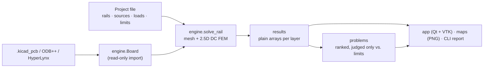

# Coppernicus: how it works

This page holds the technical background. To use the program, start from the
[README](../README.md).

## Architecture



**Engine.** The DC solver is [KiPI](https://github.com/drewsum/KiPI)'s engine, pinned to its
v1.0.1 commit. Coppernicus only talks to it through `coppernicus.engine`, the one package that
imports KiPI. A different engine can be put in by rewriting that package alone.

**Stack:** Python 3.12 · PySide6 (Qt) · pyvista/VTK for the board view · NumPy, SciPy, Shapely ·
matplotlib for the PNG maps.

## Physics

This is KiPI's DC model, checked in stage 1 (see [the analysis](kipi-analysis.md)).

- On every copper sheet, div(G_s·grad V) = 0 with sheet conductance G_s = t/ρ, solved with
  linear finite elements on a triangle mesh.
- Plated holes are resistors ρ·Δz/A between equipotential drill rings, with
  A = π(d·t_p − t_p²) for drill d and plating t_p. Via fill is counted as non-conductive.
- Source pins are held at the source voltage. Each load's current is split equally across its
  pins.
- ρ = 1.724·10⁻⁵ Ω·mm at 20 °C, α = 0.00393 /°C.
- Copper with no path to a source (a floating island) is left out and reported.

Inputs that are not in the board file, such as via plating and copper temperature, are explicit
settings. Every result lists the values that were used.

**Current density at sharp corners.** With linear elements, |J| at a re-entrant corner (the inner
corner of an L, the end of a slot) grows as the mesh gets finer: the point value is singular.
The Problems panel therefore ranks crowding spots by their area-weighted mean |J| and shows the
peak only as a mesh-dependent detail.

## Repository layout

```text
Coppernicus/
├── src/coppernicus/
│   ├── engine/          # the only code that imports KiPI: Board, solve_rail, synthetic boards
│   ├── project.py       # project file model (YAML), engine-independent
│   ├── results.py       # solve results as plain arrays
│   ├── problems.py      # ranking and limit checks
│   ├── fields.py        # field helpers: current vectors, arrows, isolines, point lookup
│   ├── maps.py          # per-layer PNG maps
│   ├── cli.py           # command line
│   └── app/             # desktop app: main window, panels, board view, background solve
├── tests/               # synthetic boards with closed-form answers; boards_local/ tests skip if absent
├── examples/demo/       # synthetic demo board and project
├── tools/               # macOS launcher, scripted GUI check, docs screenshots
├── docs/                # this page, the KiPI analysis, plans, images
└── Logo/
```

Real boards go in `boards_local/`. That folder is git-ignored, and any
`boards_local/**/*.coppernicus.yml` project in it is solved by the test suite.

## Validation

`uv run pytest` checks the engine on synthetic boards with known answers:

- a straight strip within 0.5 % of R = ρL/(w·t);
- the via barrel resistance;
- the temperature scaling (1 + α·ΔT);
- current balance and energy balance;
- net ties solved as shorts;
- clear errors for missing sources, loads and pins.

During stage 1, KiPI's import was compared with KiCad's own `pcbnew` on three real boards. The
worst difference in per-net, per-layer copper area was 1.04 %, and its sign flips when pcbnew's arc
tolerance is refined, so it comes from how via rings are approximated by polygons. KiPI's accuracy
suite (DC, AC, coupled noise) passes on macOS.

`tools/gui_check.py` drives the app from code on the demo board (pad picking, solve).
`tools/make_docs_screenshots.py` makes the README screenshots, from the synthetic demo only.

## Plans

- [Workstreams and roles](workstreams.md)
- [Functional roadmap plan](superpowers/plans/2026-11-24-coppernicus-roadmap.md)
- [Stage-1 analysis of KiPI](kipi-analysis.md)
