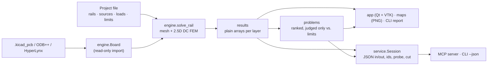

# Coppernicus: how it works

This page holds the technical background. To use the program, start from the
[README](../README.md).

## Architecture



**Engine.** The DC solver is [KiPI](https://github.com/drewsum/KiPI)'s engine, pinned to its
v1.0.1 commit. Coppernicus only talks to it through `coppernicus.engine`, the one package that
imports KiPI. A different engine can be put in by rewriting that package alone.

**Stack:** Python 3.12 · PySide6 (Qt) · pyvista/VTK for the board view · NumPy, SciPy, Shapely ·
matplotlib for the PNG maps.

## Physics

This is KiPI's DC model, checked in stage 1 (see [the analysis](kipi-analysis.md)).

- On every copper sheet, div(G_s·grad V) = 0 with sheet conductance G_s = t/ρ, solved with
  linear finite elements on a triangle mesh.
- Plated holes are resistors ρ·Δz/A between equipotential drill rings, with
  A = π(d·t_p − t_p²) for drill d and plating t_p. Via fill is counted as non-conductive.
- Source pins are held at the source voltage. Each load's current is split equally across its
  pins.
- ρ = 1.724·10⁻⁵ Ω·mm at 20 °C, α = 0.00393 /°C.
- Copper with no path to a source (a floating island) is left out and reported.

Inputs that are not in the board file, such as via plating and copper temperature, are explicit
settings. Every result lists the values that were used.

**Power tree** (`engine/tree.py`, KiPI's `solve_tree`). Every net group (nets joined by links
and net ties) is solved from its one source, ground nets included:
- a regulator's input pins are a load on the group feeding it: LDO I_in = I_out + I_q, switcher
  I_in = V_out·I_out / (η·V_in) + I_q, with V_out and V_in measured across its own pins;
- loads and regulators return their current through their ground pins, so ground rises above
  the 0 V reference held at the main source's ground pins;
- a load's drop is nominal − (lowest supply pin − highest ground pin);
- a remote-sense regulator holds its set point across the sensed pins.
The mapping from the project file to KiPI's setup is in [engine-mapping.md](engine-mapping.md).

**Current density at sharp corners.** With linear elements, |J| at a re-entrant corner (the inner
corner of an L, the end of a slot) grows as the mesh gets finer: the point value is singular.
The Problems panel therefore ranks crowding spots by their area-weighted mean |J| and shows the
peak only as a mesh-dependent detail.

## Current-density default

Verdicts are only against the user's limits. Coppernicus's one built-in default, on copper
current density, raises **attention** items and never a verdict.

**The rule.** On every rail solve and every power-tree group, without a
`max_current_density`, a current-crowding spot whose mean |J| is above

J_default(t) = 60 A/mm² · √(35 µm / t)

is a problem of severity `attention`. Its row shows the value, the layer, the default used and
the thickness.
- **t** is the layer's copper thickness as solved: the board's stackup, or the project's
  `copper_thickness_mm` what-if.
- **Two constants,** one for outer and one for inner layers, are both 60 A/mm² at 1 oz (35 µm)
  for now (`DENSITY_DEFAULT_EXTERNAL_A_MM2` and `DENSITY_DEFAULT_INTERNAL_A_MM2` in
  `problems.py`), so they can diverge later.
- **The scaling** follows TI SLUA366: the current goes ×√2 when the thickness doubles.

| Copper | t | J_default |
|---|---:|---:|
| 0.5 oz | 17.5 µm | 84.9 A/mm² |
| 1 oz | 35 µm | 60 A/mm² |
| 2 oz | 70 µm | 42.4 A/mm² |
| 3 oz | 105 µm | 34.6 A/mm² |

**How it is measured.** Exactly as a `max_current_density` is: the connected copper at or
above the threshold is one spot, judged by its area-weighted mean |J|, not by the
single-triangle peak. A spot of a few triangles at a corner or a via edge can be a mesh effect:
solve again with a smaller `max_edge_mm` before taking it as real. Every spot above the default
is listed, between the fails and the ranked items, so a ranked spot can sit on the same copper.

**What it changes.** It changes no verdict, no `not_judged` list and no exit code (CLI, CI,
MCP). The app shows amber ATTENTION rows and counts them apart from "limit(s) exceeded". The
CLI text, the JSON documents (problem `severity: "attention"`, with `default_j_a_mm2` and
`thickness_mm`, and an `attention` count), the HTML report (an ATTENTION badge) and the CI job
summary (a count) show them too. A `max_current_density` the user sets replaces the default on
that rail or group: a FAIL when it is exceeded, and no attention items there. Every result has
one assumption line with each layer's value.

**Why 60 A/mm² at 1 oz.** The published figures for 1 oz copper fall around 60-70 A/mm²:
- **IPC-2221:** I = k·ΔT^0.44·A^0.725, with k = 0.048 for external and 0.024 for internal
  layers and A in mil². At 1 oz, 1 mm wide, external, ΔT 10 °C (A = 54.25 mil²), it gives
  I ≈ 2.39 A, so J ≈ 68 A/mm². The ×0.5 for internal layers is the old convention.
- **IPC-2152,** as fitted by KiCad's calculator
  ([tracks_width_versus_current_formula.md](https://gitlab.com/kicad/code/kicad/-/raw/master/pcb_calculator/tracks_width_versus_current_formula.md)):
  about 60 A/mm² for a 10 °C rise at 1 oz and 1 mm. Internal layers are not derated.
- **TI SLUA366** ([ti.com/lit/pdf/slua366](https://www.ti.com/lit/pdf/slua366)): its 1 oz table
  never goes below 67.5 A/mm², and the current goes ×√2 per doubling of the thickness.
- **Würth Elektronik** ([PCB heat management](https://www.we-online.com/files/pdf1/pcb-heat-management.pdf)):
  about 67 A/mm² for 10 A at a 45 K rise.
- **Brooks and Adam** ([Internal trace temperatures](https://signalintegrityjournal.com/articles/1596-internal-trace-temperatures-more-complicated-than-we-think)):
  internal traces run cooler. With IPC-2152, that is why inner layers are not derated here.

Electromigration in copper sets in about 100× higher, so it is not the limit here.

**Why attention only, never a fail.** Current density is not temperature:
- **Short necks are often fine.** Schimel
  ([Efficient tool sizes high-current PCB traces](https://www.electronicdesign.com/boards/efficient-tool-sizes-high-current-pcb-traces))
  finds that short bottlenecks take about 3.3× more current. Harris at Altium
  ([Copper current density simulations](https://resources.altium.com/p/copper-current-density-simulations-quick-and-dirty-way))
  writes: "Some areas exceeding this current density are likely going to be fine."
- **Wide copper can heat a lot below it.** A wide pour carrying a high current can heat the
  board a lot while no spot goes over the default.

The board temperature (the power tree with `thermal`, judged by `max_rise_c`) is the real
thermal check. The default only points at where to look.

## Repository layout

```text
Coppernicus/
├── src/coppernicus/
│   ├── engine/          # the only code that imports KiPI: Board, solve_rail, synthetic boards
│   ├── project.py       # project file model (YAML), engine-independent
│   ├── results.py       # solve results as plain arrays
│   ├── problems.py      # ranking and limit checks
│   ├── fields.py        # field helpers: current vectors, arrows, isolines, point lookup
│   ├── maps.py          # per-layer PNG maps
│   ├── service/         # Session: boards and results by id, JSON functions, probe, cross-section cut
│   ├── mcp_server.py    # MCP tools over the service (coppernicus mcp)
│   ├── cli.py           # command line (--json goes through the service)
│   └── app/             # desktop app: main window, panels, board view, background solve
├── tests/               # synthetic boards with closed-form answers; boards_local/ tests skip if absent
├── examples/demo/       # synthetic demo board and project
├── tools/               # macOS launcher, scripted GUI check, docs screenshots
├── skills/              # Claude Code skill for agents that use the MCP server
├── docs/                # this page, the KiPI analysis, plans, images
└── Logo/
```

Real boards go in `boards_local/`. That folder is git-ignored, and any
`boards_local/**/*.coppernicus.yml` project in it is solved by the test suite.

## Validation

`uv run pytest` checks the engine on synthetic boards with known answers:

- a straight strip within 0.5 % of R = ρL/(w·t);
- the via barrel resistance;
- the temperature scaling (1 + α·ΔT);
- current balance and energy balance;
- net ties solved as shorts;
- clear errors for missing sources, loads and pins.

During stage 1, KiPI's import was compared with KiCad's own `pcbnew` on three real boards. The
worst difference in per-net, per-layer copper area was 1.04 %, and its sign flips when pcbnew's arc
tolerance is refined, so it comes from how via rings are approximated by polygons. KiPI's accuracy
suite (DC, AC, coupled noise) passes on macOS.

`tools/gui_check.py` drives the app from code on the demo board (pad picking, solve).
`tools/make_docs_screenshots.py` makes the README screenshots, from the synthetic demo only.

## Plans

- [Workstreams and roles](workstreams.md)
- [Functional roadmap plan](superpowers/plans/2026-11-24-coppernicus-roadmap.md)
- [Stage-1 analysis of KiPI](kipi-analysis.md)
