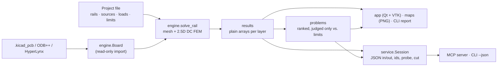
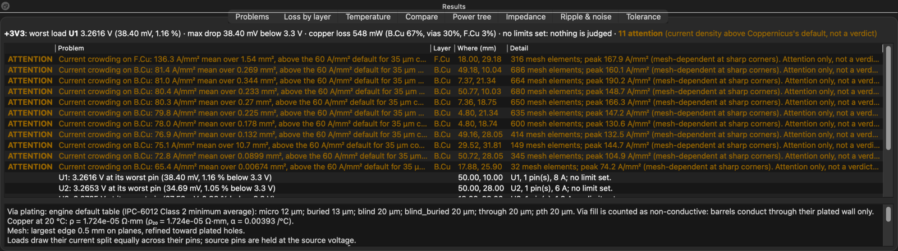

# Coppernicus: how it works

This page holds the technical background. To use the program, start from the
[README](../README.md).

## Architecture



**Engine.** The DC solver is [KiPI](https://github.com/drewsum/KiPI)'s engine, pinned to its
v1.0.1 commit. Coppernicus only talks to it through `coppernicus.engine`, the one package that
imports KiPI. A different engine can be put in by rewriting that package alone.

**Stack:** Python 3.12 · PySide6 (Qt) · pyvista/VTK for the board view · NumPy, SciPy, Shapely ·
matplotlib for the PNG maps.

## Physics

This is KiPI's DC model, checked in stage 1 (see [the analysis](kipi-analysis.md)).

- On every copper sheet, div(G_s·grad V) = 0 with sheet conductance G_s = t/ρ, solved with
  linear finite elements on a triangle mesh.
- Plated holes are resistors ρ·Δz/A between equipotential drill rings, with
  A = π(d·t_p − t_p²) for drill d and plating t_p. Via fill is counted as non-conductive.
- Source pins are held at the source voltage. Each load's current is split equally across its
  pins.
- ρ = 1.724·10⁻⁵ Ω·mm at 20 °C, α = 0.00393 /°C.
- Copper with no path to a source (a floating island) is left out and reported.

Inputs that are not in the board file, such as via plating and copper temperature, are explicit
settings. Every result lists the values that were used.

**Power tree** (`engine/tree.py`, KiPI's `solve_tree`). Every net group (nets joined by links
and net ties) is solved from its one source, ground nets included:
- a regulator's input pins are a load on the group feeding it: LDO I_in = I_out + I_q, switcher
  I_in = V_out·I_out / (η·V_in) + I_q, with V_out and V_in measured across its own pins;
- loads and regulators return their current through their ground pins, so ground rises above
  the 0 V reference held at the main source's ground pins;
- a load's drop is nominal − (lowest supply pin − highest ground pin);
- a remote-sense regulator holds its set point across the sensed pins.
The mapping from the project file to KiPI's setup is in [engine-mapping.md](engine-mapping.md).

**Factorization order.** KiPI factorizes its sparse systems with SciPy's SuperLU in the COLAMD
column order, which ignores that they are symmetric. By default Coppernicus has the board
temperature's heat model and the DC copper's direct solves factored in SuperLU's symmetric mode
instead (`engine/superlu_order.py`): about half the fill, so on a large board about half the time
and memory of the electro-thermal solve (measured on a large private test board). Numbers stay equal within the documented round-off criteria (each factorization is
checked as KiPI checks the ones it does not trust, and redone by KiPI if it fails); the AC solves
keep KiPI's order unless `ac` is named. `COPPERNICUS_SUPERLU_ORDER=off` restores KiPI's method
exactly. A DC system above KiPI's 200,000-unknown direct limit, which KiPI solves with AMG-CG, is
factorized directly up to 400,000 unknowns by default (within KiPI's SuperLU limit and half the
free memory): about half the time on large rails for about a quarter more memory, equal within
1e-9; `COPPERNICUS_DC_DIRECT_MAX=0` or empty restores KiPI's rule, any other value sets the
ceiling. Details, criteria and evidence: [engine-mapping.md](engine-mapping.md).

**Current density at sharp corners.** With linear elements, |J| at a re-entrant corner (the inner
corner of an L, the end of a slot) grows as the mesh gets finer: the point value is singular.
The Problems panel therefore ranks crowding spots by their area-weighted mean |J| and shows the
peak only as a mesh-dependent detail.

**The |J| colour scale and the label above it.** Every |J| map (the HTML report, the PNG maps,
the app) tops its colour scale at the layer's 99.5th percentile of |J|, degenerate triangles
(below) left out, so a few corner triangles do not turn the rest of the copper dark. Copper above
that top takes the top colour. Because crowded copper can be well under 0.5 % of a layer, the
map alone does not say how far above the top it goes, so above the colour bar each map writes,
for the layer shown:

1. *Peak 220 A/mm² (mesh-dependent)*: the point maximum |J|, degenerate triangles left out. It
   is never judged.
2. When a limit applies, the layer's verdict as the problem list judged it, read off that list
   and never judged again (`problems.density_check`), so it uses the spots' area-weighted means:
   - against your `max_current_density` (a tree group's strictest over its nets):
     *limit 60 A/mm²: FAIL · worst spot 89.1 A/mm² over 3.02 mm²* (with *· 12 spots above* when
     there are more), or *limit 60 A/mm²: pass*. A spot is copper at or above the limit, so a
     peak above your limit always lies in a failed spot. When every failed spot on the layer is
     under 3 mesh elements, the line adds *may be a mesh artefact* (the problem's own check).
     The mean |J| of a crowding spot depends on the mesh, with either mesher (rust or
     Triangle): typically 1-2 % on detailed boards, up to about 6 %; on a spot of only a few
     elements at a sharp copper corner neither mesher converges, and the two can differ by more
     (15 % seen on a real board). A result judged against your `max_current_density` says so in
     an assumption line: read a spot within a few percent of the limit, or one of only a few
     elements, with care;
   - without one, against the [current-density default](#current-density-default) for the
     layer's thickness: *default 60 A/mm² (attention): 3 spots above · worst ...*, or *below*.
     A peak above the default with no attention spot (only slivers of 1 or 2 elements, at a
     corner or a via wall) adds *peak above the default at a corner; spots below*;
   - a tree group that did not converge: *not judged (did not converge)*.

The PNG maps take the problem list they are given (`render_layer_map(..., problems)`, which
keeps the limits that judged it, or `limits=`); without either they write the peak only, and
`render_layer_map` returns the lines as `label`.

## Current-density default

Verdicts are only against the user's limits. Coppernicus's one built-in default, on copper
current density, raises **attention** items and never a verdict.

<p align="center">
  
</p>

**The rule.** On every rail solve and every power-tree group, without a
`max_current_density`, a current-crowding spot whose mean |J| is above

J_default(t) = 60 A/mm² · √(35 µm / t)

is a problem of severity `attention`. Its row shows the value, the layer, the default used and
the thickness.
- **t** is the layer's copper thickness as solved: the board's stackup, or the project's
  `copper_thickness_mm` what-if.
- **Two constants,** one for outer and one for inner layers, are both 60 A/mm² at 1 oz (35 µm)
  for now (`DENSITY_DEFAULT_EXTERNAL_A_MM2` and `DENSITY_DEFAULT_INTERNAL_A_MM2` in
  `problems.py`), so they can diverge later.
- **The scaling** follows TI SLUA366: the current goes ×√2 when the thickness doubles.

| Copper | t | J_default |
|---|---:|---:|
| 0.5 oz | 17.5 µm | 84.9 A/mm² |
| 1 oz | 35 µm | 60 A/mm² |
| 2 oz | 70 µm | 42.4 A/mm² |
| 3 oz | 105 µm | 34.6 A/mm² |

**How it is measured.** Exactly as a `max_current_density` is: the connected copper at or
above the threshold is one spot, judged by its area-weighted mean |J|, not by the
single-triangle peak. Every current-density item gives its mesh element count (`elements`, and
"N mesh elements" in its detail). Every spot above the default is listed, between the fails and
the ranked items, except the slivers below.

**Slivers below the mesh's resolution.** A spot of fewer than 3 mesh elements
(`MIN_SPOT_ELEMENTS` in `problems.py`) is not an attention item. This is a numerical-resolution
rule, not a physical limit: no published source gives a minimum spot size. What was measured on
the examples (demo-thermal, noise) and the synthetic boards: every spot of 1 to 4 elements has
a node on a vertex of the 16-sided polygon that models a via's drill wall, and the 1- and
2-element ones sit 0.5 to 6 % above the default. Refined near the holes (`min_edge_mm` 0.02 →
0.01 → 0.005 mm, `grading` 0.2 → 0.1 → 0.05) they appear, split, merge or vanish instead of
converging. The resolved spots beside them converge: their area stays within about 20 %, their
mean |J| within a few %, their element count grows (32 → 85 → 170 at one via) and only their
peak rises (5 to 11 % each time `min_edge_mm` halves). A dropped sliver's copper is not taken
as listed, so a ranked spot around it is still listed. Against a `max_current_density` the
user sets, every spot is judged, whatever its size: a failed spot of fewer than 3 elements
stays a fail, and its detail says it may be a mesh artefact at a via wall, how to check it
(a smaller `min_edge_mm` and `grading`) and, if it stays, to widen the copper there or add a via. To see the slivers, or to check any small
spot, refine the mesh near the holes and solve again (next paragraph).

**Degenerate triangles, below the input's resolution.** KiPI snaps the board geometry to a
1 nm grid before meshing (`NODING_GRID_MM` in `kipi/core/mesh/mesher.py`). A mesh triangle with
an edge shorter than 1 nm therefore comes from points the mesher added, below the input's
resolution, and its |J| is set by the last bits of the node voltages. One with edges of a few
tenths of a nanometre (an area near 1e-14 mm²) can hold a rail's point maximum, and a neutral
reordering of the solve then moves that value in its seventh digit. Such triangles are left
out of every maximum or peak |J|: the point maximum (`j_point_max_a_mm2`), each spot's peak, a
cut's `max_abs_j_a_mm2`, and the top of the |J| colour scale in the HTML report, the PNG maps
and the app. They are neither seeds nor members of a spot, so one cannot make a spot of its own
or count toward the 3 elements above. This is the resolution of the input, not a physical
threshold. They stay in the solution, the copper loss and the areas; their area is negligible,
so a spot's area-weighted mean, which every limit and the default judge, is unchanged. The one
difference in verdicts: a spot made only of degenerate triangles is no longer listed, so it no
longer fails against a `max_current_density` either. When any were left out, the result's
warnings say so once, with each layer's count and the largest |J| among them, and the JSON has
`degenerate_triangles`. The examples have none: their shortest mesh edge is 2 µm.

**Refining the mesh near holes.** `max_edge_mm` sets the mesh on planes. Near plated holes
KiPI grades it: elements start at `min_edge_mm` (0.02 mm) on the hole wall and grow by `grading`
(0.2 mm per mm of distance) up to `max_edge_mm`. A smaller `max_edge_mm` leaves the elements at
a via wall as they were: halved to 0.25 mm, it left the small via-edge spots of the examples
with the same element counts and their mean |J| within 0.2 % (the larger via spots within 0.4 %). To check a spot near a via, set the advanced settings `min_edge_mm` (for
example 0.01) and `grading` (for example 0.1) and solve again: a spot that keeps its area and
mean |J| is resolved. Unset, KiPI's defaults apply.

**Each spot is listed once.** A ranked (top 1 %) spot that shares copper with an attention or
failed spot on the same layer, one mesh triangle being enough, is not listed again: the same
copper, or a wider ranked region around a spot above the default. The `top` ranked spots
(`--top`, default 5) are counted after that, so the attention items come on top of them and the
ranked rows show the strongest spots not already listed; a failed spot still counts in the
`top`. The HTML report's "Strongest current crowding" card takes the strongest spot of any
severity.

**What it changes.** It changes no verdict, no `not_judged` list and no exit code (CLI, CI,
MCP). The app shows amber ATTENTION rows and counts them apart from "limit(s) exceeded". The
CLI text, the JSON documents (problem `severity: "attention"`, with `default_j_a_mm2` and
`thickness_mm`, and an `attention` count), the HTML report (an ATTENTION badge) and the CI job
summary (a count) show them too. A `max_current_density` the user sets replaces the default on
that rail or group: a FAIL when it is exceeded, and no attention items there. Every result has
one assumption line with each layer's value.

**Why 60 A/mm² at 1 oz.** The published figures for 1 oz copper fall around 60-70 A/mm²:
- **IPC-2221:** I = k·ΔT^0.44·A^0.725, with k = 0.048 for external and 0.024 for internal
  layers and A in mil². At 1 oz, 1 mm wide, external, ΔT 10 °C (A = 54.25 mil²), it gives
  I ≈ 2.39 A, so J ≈ 68 A/mm². The ×0.5 for internal layers is the old convention.
- **IPC-2152,** as fitted by KiCad's calculator
  ([tracks_width_versus_current_formula.md](https://gitlab.com/kicad/code/kicad/-/raw/master/pcb_calculator/tracks_width_versus_current_formula.md)):
  about 60 A/mm² for a 10 °C rise at 1 oz and 1 mm. Internal layers are not derated.
- **TI SLUA366** ([ti.com/lit/pdf/slua366](https://www.ti.com/lit/pdf/slua366)): its 1 oz table
  never goes below 67.5 A/mm², and the current goes ×√2 per doubling of the thickness.
- **Würth Elektronik** ([PCB heat management](https://www.we-online.com/files/pdf1/pcb-heat-management.pdf)):
  about 67 A/mm² for 10 A at a 45 K rise.
- **Brooks and Adam** ([Internal trace temperatures](https://signalintegrityjournal.com/articles/1596-internal-trace-temperatures-more-complicated-than-we-think)):
  internal traces run cooler. With IPC-2152, that is why inner layers are not derated here.

Electromigration in copper sets in about 100× higher, so it is not the limit here.

**Why attention only, never a fail.** Current density is not temperature:
- **Short necks are often fine.** Schimel
  ([Efficient tool sizes high-current PCB traces](https://www.electronicdesign.com/boards/efficient-tool-sizes-high-current-pcb-traces))
  finds that short bottlenecks take about 3.3× more current. Harris at Altium
  ([Copper current density simulations](https://resources.altium.com/p/copper-current-density-simulations-quick-and-dirty-way))
  writes: "Some areas exceeding this current density are likely going to be fine."
- **Wide copper can heat a lot below it.** A wide pour carrying a high current can heat the
  board a lot while no spot goes over the default.

The board temperature (the power tree with `thermal`, judged by `max_rise_c`) is the real
thermal check. The default only points at where to look.

## Repository layout

```text
Coppernicus/
├── src/coppernicus/
│   ├── engine/          # the only code that imports KiPI: Board, rail and tree solves, board
│   │                    #   temperature, AC impedance, noise, tolerance, synthetic boards
│   ├── project.py       # project file model (YAML), engine-independent
│   ├── board_fields.py  # rails, converters, links and models from KiCad footprint fields
│   ├── results.py       # solve results as plain arrays
│   ├── problems.py      # ranking and limit checks
│   ├── power_tree.py, temperature.py, impedance.py, coupled_noise.py, tolerance.py
│   │                    #   verdicts, summaries, text and files of each analysis (no engine)
│   ├── fields.py        # field helpers: current vectors, arrows, isolines, point lookup
│   ├── maps.py          # per-layer PNG maps
│   ├── report.py        # offline HTML report (page, style and script in report_assets/)
│   ├── service/         # Session: boards and results by id, JSON functions, probe, cross-section cut
│   ├── mcp_server.py    # MCP tools over the service (coppernicus mcp)
│   ├── cli.py           # command line (--json goes through the service)
│   ├── ci.py            # the GitHub Action's helper (python -m coppernicus.ci)
│   ├── bootstrap_triangle.py  # the packaged app's first-start download of Triangle
│   └── app/             # desktop app: main window, panels, board view, background solve
├── tests/               # synthetic boards with closed-form answers; boards_local/ tests skip if absent
├── examples/            # synthetic boards and projects: demo, power_chain, fields, pdn, noise, tolerance
├── packaging/           # PyInstaller spec and build scripts of the packaged app
├── action.yml           # the GitHub Action
├── tools/               # macOS launcher, scripted GUI check, docs screenshots
├── skills/              # Claude Code skill for agents that use the MCP server
├── docs/                # this page, the KiPI analysis, plans, images
└── Logo/
```

Real boards go in `boards_local/`. That folder is git-ignored, and any
`boards_local/**/*.coppernicus.yml` project in it is solved by the test suite.

## Validation

`uv run pytest` checks the engine on synthetic boards with known answers:

- a straight strip within 0.5 % of R = ρL/(w·t);
- the via barrel resistance;
- the temperature scaling (1 + α·ΔT);
- current balance and energy balance;
- net ties solved as shorts;
- clear errors for missing sources, loads and pins.

During stage 1, KiPI's import was compared with KiCad's own `pcbnew` on three real boards. The
worst difference in per-net, per-layer copper area was 1.04 %, and its sign flips when pcbnew's arc
tolerance is refined, so it comes from how via rings are approximated by polygons. KiPI's accuracy
suite (DC, AC, coupled noise) passes on macOS.

`tools/gui_check.py` drives the app from code on the synthetic examples (pad picking, solves,
the power tree, the KiCad fields and the analysis tabs).
`tools/make_docs_screenshots.py` makes the README screenshots, from the synthetic demo only.

## Plans

- [Workstreams and roles](workstreams.md)
- [Functional roadmap plan](superpowers/plans/2026-11-24-coppernicus-roadmap.md)
- [Stage-1 analysis of KiPI](kipi-analysis.md)
