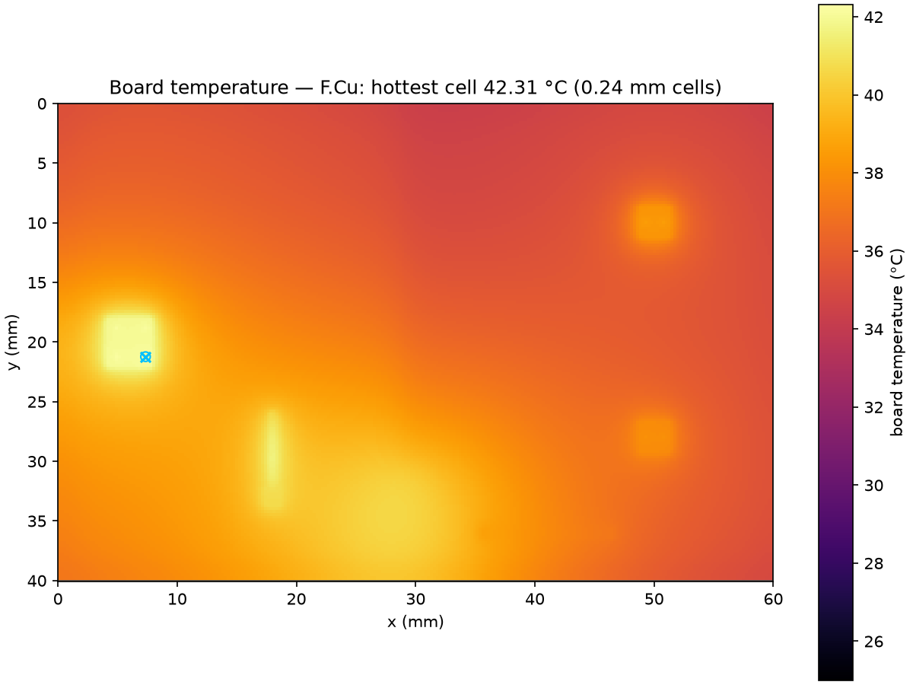

# Board temperature

Copper heats up with its own losses, and hot copper conducts worse, so the drop grows. The
**board temperature** solves both together: the power tree is solved, its losses heat the board,
the board's temperature is solved, the copper is solved again at that temperature, and so on
for a few iterations (KiPI's electro-thermal co-simulation). It gives a temperature map of each
copper layer, the hottest copper of each layer, and each load's drop at the ambient and hot.

It is part of the [power tree](power-tree.md): a rail solved on its own is never heated.

<p align="center">
  
</p>

## Run it

- **App:** in the **Temperature** tab, tick **Electro-thermal: Solve power tree heats the
  copper**, set the options, then **Solve power tree** (Ctrl+T).
- **Command line:** `coppernicus solve PROJECT --thermal` (it implies `--tree`); `--tree` alone
  does it too when the project enables it. One PNG per copper layer is written next to the
  summary (`<project>_temperature_<layer>.png`), unless `--no-maps`; `--html` adds the
  [Board temperature section](html-report.md#board-temperature) to the tree report.
- **Agents:** the MCP tool `solve_tree` with `thermal: true`, and `thermal_options` for a
  what-if (see [Agents](agents.md#board-temperature)).
- **CI:** with the Action's `tree` input, a project that enables it is solved and judged by it
  (see [CI](ci.md)).

Try it on `examples/demo/demo-thermal.coppernicus.yml`: the demo rail at 8 + 6 + 1.2 A, with a
15 °C rise limit.

## The settings

The project file's `thermal:` block, the **Electro-thermal options** in the app. Every key is
optional and the defaults are KiPI's:

```yaml
thermal:
  enabled: true          # Solve power tree also solves the temperature
  ambient_c: 25.0        # °C
  airflow_m_s: 0.0       # air speed over the board
  iterations: 3          # electro-thermal passes, at least 1
  grid_mm: 0.0           # thermal cell size; 0 = automatic (about 250 cells across)
  load_heat: false       # also the loads' own power, at their pins
  regulator_heat: output_pads   # or part_pads: where a regulator's loss goes
  max_temp_c: 85.0       # a limit on the hottest copper, °C (example)
  max_rise_c: 15.0       # a limit on its rise above the ambient (example)
```

What heats the board: each copper triangle's loss where it is, each via barrel's loss over the
layers it spans, each link's loss at its pads, each regulator's conversion loss (input − output
power) at its output pads (`output_pads`) or spread over all its pads (`part_pads`), and with
`load_heat` the loads' own power. The board loses heat by convection from both faces, h = 10 +
3.8·v W/m²K (KiPI's; natural convection and radiation at 0 m/s).

## Cost first

The thermal model is a grid over the whole board, one unknown per cell and copper layer, and
its memory grows fast with the grid. Before it solves, Coppernicus says what it will cost, from
the same estimate the app shows:

```text
Board temperature: 250 × 167 cells of 0.24 mm (automatic), 41,750 inside the board, × 2 copper layers: 83,500 unknowns; ...
```

followed by the memory of the model against this machine's. A coarser grid (`grid_mm`) lowers
it. The app asks before a solve that could exceed the memory; an agent's call is refused
(`solve_too_large`) until confirmed.

## Reading the results

On the thermal demo:

```text
Board temperature (electro-thermal: 3 iterations, settled; ambient 25 °C, airflow 0 m/s; grid 250 × 167 cells of 0.24 mm)
  grid peak 42.31 °C (rise 17.31 °C) on F.Cu at (7.32, 21.24) mm, nearest pad J1.1 (0.00 mm): shown, not judged
  history: 41.33 → 42.26 → 42.31 °C, last change 0.0514 °C
  heat 0.591 W (copper 0.414 W, vias 0.177 W)
  layer         hottest       rise  at (x, y) mm       group      nearest pad          verdict
  F.Cu         42.29 °C   17.29 °C  (7.34, 21.23)      +3V3       J1.1 0.00 mm         FAIL
  B.Cu         41.77 °C   16.77 °C  (28.82, 31.66)     +3V3       R1.2 7.71 mm         FAIL
  load drops, copper at the ambient (iteration 1) → electro-thermal:
    U1             +3V3       39.156 → 41.354 mV (+5.6 %)
    U2             +3V3       35.375 → 37.399 mV (+5.7 %)
    U3             +3V3       28.065 → 29.780 mV (+6.1 %)
```

- **The grid peak** is the hottest cell anywhere, on any layer: shown, never judged. It can sit
  on laminate, or on copper of a net that is not solved.
- **Each layer's hottest copper** is read on the solved copper: these rows are what the limits
  judge, with the nearest pad to say where.
- **History**: the hottest temperature after each iteration. *Settled* means the last iteration
  changed no cell by more than 5 % of the peak rise (KiPI's rule).
- **Load drops**: each load's drop with the copper at the ambient (iteration 1) and hot. Here the
  heat adds about 6 % to every drop.

## Verdicts

Only your `max_temp_c` and `max_rise_c` judge, and only the hottest solved copper of each layer.

- A layer over a limit **fails**, settled or not.
- Otherwise the temperature is **not judged** when the solve did not settle, ran one iteration
  (settling not checked), a group did not converge, or there is no solved copper; and when the
  project sets limits but the tree was solved without the temperature.
- Rail by rail (`coppernicus solve` without `--tree`, the app's F5), the temperature is not
  solved: its limits are listed as **not judged** (exit 3), never passed.
- With no limit, nothing is judged.

The board temperature counts as one more group in the tree's verdict and the exit code. The
full table is in [engine-mapping.md](engine-mapping.md#verdict-coordinators-rulings-coppernicustemperature).

## What it does not model

Heat sinks, enclosures, mounting hardware and edge clamps (convection only); the packages of
parts (a regulator's loss goes into the copper at its pads, as a point: read regulator-pad
temperatures as rough; there is no junction temperature); transient heating. Each laminate is
recognised by its material name, and an unknown name is taken as FR4 core; the assumptions name
every laminate and what it was taken as.

## Documentation

- [Power tree](power-tree.md): regulators, ground return, groups and verdicts.
- [Board temperature](thermal.md): the electro-thermal solve of the power tree.
- [PDN impedance](ac-impedance.md): |Z|(f) at the probes, against your targets.
- [Ripple and coupled noise](noise.md): a switcher's ripple and the noise in victim nets, against your margins.
- [KiCad footprint fields](kicad-fields.md): the power data on the parts, in KiCad.
- [What-if and compare](what-if-and-compare.md): copper thickness, Pin as baseline, revisions.
- [HTML report](html-report.md): the offline pages of a solve, the power tree, the impedance and the noise.
- [CI](ci.md): the GitHub Action for KiCad repositories.
- [Agents](agents.md): the MCP server and the `--json` command line for AI agents.
