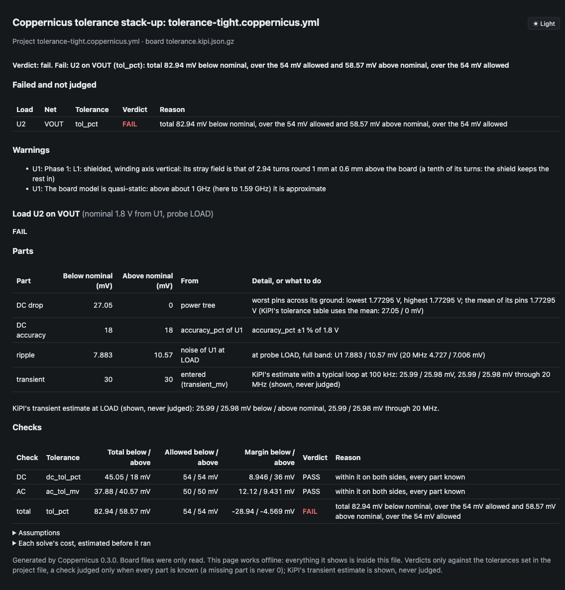

# Tolerance stack-up

A chip's datasheet gives its supply a band: 1.8 V ± 5 %, or −3 / +2 %. Several things eat
into that band at once: the DC drop in the copper, the regulator's own DC accuracy, the
switcher's ripple, and the dip or overshoot when the load steps. Each one alone can look small
while their sum is over. Coppernicus adds them up **per load, each side apart** (below and
above nominal), and judges the sum only against the **tolerance you entered**, and only
**when every part is known**.

## What it adds up

Four parts per load, each a deviation in mV from nominal, below and above:

- **DC drop**, from the power tree on the load's **worst pins**: below = nominal − (lowest
  supply pin − highest ground pin), above = (highest supply pin − lowest ground pin) − nominal,
  each at least 0. With the board temperature enabled (`thermal: enabled: true`) the tree is
  solved electro-thermally.
- **DC accuracy** of the source driving the load's rail (`accuracy_pct` or `accuracy_mv`).
- **Ripple** at the load's probe, from the noise solve of every aggressor that lists that probe
  in its `ripple_probes` (see [Ripple and coupled noise](noise.md)), added by the sum of their
  peaks (or the root sum of squares, KiPI's rule); or the `ripple_mv` you entered; the larger
  per side when both are there.
- **Transient**: the `transient_mv` you entered. KiPI's own estimate (the open-loop |Z| at the
  probe with a typical control loop crossing over at the bandwidth you give) is **shown next to
  it, never judged**.

Three checks, each against its own tolerance:

| Check | Adds | Against |
|---|---|---|
| DC | DC drop + DC accuracy | `dc_tol_pct` or `dc_tol_mv` |
| AC | ripple + transient | `ac_tol_pct` or `ac_tol_mv` |
| total | all four | `tol_pct` or `tol_mv` |

Nominal is the set voltage of the source that drives the load's rail. The arithmetic and
limits are KiPI's (`kipi/tolerance`); what counts as known is Coppernicus's. Every rule is in
[engine-mapping.md](engine-mapping.md#task-11-tolerance-stack-up--kipitolerance-kipitoleranceevaluatepy-kipitolerancegatherpy).

## What you enter

In the project file, on the loads and the sources you already have (from
`examples/tolerance/tolerance.coppernicus.yml`, shortened):

```yaml
rails:
- net: VOUT
  sources:
  - name: U1
    ref: L1
    voltage: 1.8
    kind: smps
    accuracy_pct: 1.0      # the regulator's DC accuracy: ±1 % (or accuracy_mv)
  loads:
  - ref: U2
    current: 5.0
    tol_pct: 6.0           # the whole band: ±6 % of nominal (or tol_mv)
    dc_tol_pct: 3.0        # its DC share (optional)
    ac_tol_mv: 50.0        # its AC share (optional)
    transient_mv: 30.0     # a datasheet or measured figure
    # ripple_mv: 10.0      # likewise, where no aggressor's ripple is solved
probes:
- name: LOAD               # on U2's pins: the load's probe
  ref: U2
  net: VOUT
  pins: ['1']
  step_a: 1.0              # a load step, for KiPI's transient estimate (shown)
  slew_a_per_us: 1.0
ac:
  bandwidth_hz:
    U1: 100000.0           # KiPI's estimate is shown only with a bandwidth you give
aggressors:
- name: U1
  ripple_probes: [LOAD]    # the switcher's ripple, read at U2's probe
tolerance:                 # optional
  ripple_sum: linear       # or rss
  bw_limit_20mhz: false    # true: judge the ripple through a 20 MHz limit, as a scope
```

- A number `n` is ± n. A signed pair `[below, above]` is written as datasheets write it,
  `[-3, 2]`: below ≤ 0 and above ≥ 0. `0` is a value. A key's `_pct` and its `_mv` together are
  an error.
- `ripple_mv` and `transient_mv` are mV from nominal, in volts' direction (on a negative rail,
  below = more negative).
- The load's probe is the probe on its supply pins (and ground pins, where both have them),
  else on the same part and net.
- **In KiCad:** a load's tolerances can sit on its library symbol as `PI_TOL`, `PI_DC_TOL` and
  `PI_AC_TOL`, a source's accuracy as `PI_ACC` (`5%`, `50mV`, or `-3%,+5%` below and above; see
  [KiCad footprint fields](kicad-fields.md#tolerances-and-accuracy)). A field wins over the
  project's value for the same part, with a warning when they differ, unless the rail sets
  `override_board_fields: true`. What the fields do not give (`ripple_mv`, `transient_mv`, a
  tolerance the part has no field for) is kept from the project by part reference ("ripple_mv
  of U1 from the project file" in the assumptions); a part the fields' rail does not have loses
  the project's values, with a warning, and each lost tolerance is **not judged**. A capacitor
  model from KiCad fields counts in the AC and noise solves only when complete: a partial one
  is no model, so what depends on it is not judged.
- A key that looks like a misspelt tolerance (`tol_pc`, `acuracy_pct`) is a warning, "did you
  mean 'tol_pct'?", and the load is not judged: a typo never ends in a silent pass.

## Run it

- **App:** the Tolerance tab, after "Ripple & noise". Its editor holds each load's
  tolerances and entered parts, each source's accuracy and the `tolerance:` options; the table
  is built only from the results the app already holds (a stale one counts as missing), and
  its Solve button runs the selected load's next missing solve in the tab that owns it. A
  value a part's KiCad field gives (`PI_TOL`, `PI_DC_TOL`, `PI_AC_TOL`, `PI_ACC`) is the one
  used, so its cells (both units: `PI_TOL "5%"` holds `tol_pct` and `tol_mv`) are read-only,
  greyed, showing the field's value; the tooltip names the field and the part, e.g.
  `from KiCad field PI_ACC "1%" on U3; change it in KiCad, or set override_board_fields: true
  on rail +3V3 to use the project's`. The row's other cells stay editable. Export writes the
  CLI's two files.
- **Command line:** `coppernicus tolerance PROJECT` solves the power tree, then only what a
  load with a tolerance needs: one AC solve per rail (KiPI's transient estimate, when a probe
  has a step and its source a bandwidth) and one noise solve per aggressor listing such a
  probe (the ripple). It writes `<project>_tolerance.csv` and `<project>_tolerance_summary.json`
  into `--out` (default `results/` next to the project); `--json` prints that document, and
  `--html [PATH]` writes an offline page (see
  [HTML report](html-report.md#the-tolerance-page)). `--skip-ac` and `--skip-noise` leave
  those solves out (the parts they give are then missing, and the hints say which flag);
  `--no-board-fields` ignores the KiCad fields. Try
  `examples/tolerance/tolerance.coppernicus.yml` (passes) and `tolerance-tight.coppernicus.yml`
  (fails).
- **Agents:** the MCP tool `solve_tolerance` (see [Agents](agents.md#tolerance-stack-up)).
- **CI:** the Action's `tolerance` input, off by default (see [CI](ci.md)).

The tree is cheap; the AC and noise solves are heavy on a large board and run only where a
load with a tolerance needs them. Before anything is solved, Coppernicus says what each will
cost, with the same estimates as `coppernicus ac` and `coppernicus noise`:

```text
Impedance of VOUT: 5,708 triangles × 2 ports, the copper solved at 111 frequencies: ... About 5,708 unknowns: one factorization, with the mesh and the model, needs up to 0.0616 GB of this machine's ...
Noise of U1: 14,799 triangles × 5 ports, the copper solved at 34 frequencies: ...; 1592 harmonics to 1.592 GHz. About 14,059 unknowns: the noise solve may peak at up to 0.706 GB of this machine's ...
```

The command line only warns when a solve could exceed this machine's memory; an agent's call
is refused (`solve_too_large`) until the user confirms, or until `skip_ac` / `skip_noise`
leave the heavy solve out.

## Reading the results

On `examples/tolerance/tolerance-tight.coppernicus.yml` (U2 at ±3 %):

```text
Load U2 on VOUT (nominal 1.8 V from U1, probe LOAD): FAIL
  DC drop      27.05 / 0 mV  power tree; worst pins across its ground: ...
  DC accuracy  18 / 18 mV  accuracy_pct of U1; accuracy_pct ±1 % of 1.8 V
  ripple       7.883 / 10.57 mV  noise of U1 at LOAD; at probe LOAD, full band: U1 7.883 / 10.57 mV (20 MHz 4.727 / 7.006 mV)
  transient    30 / 30 mV  entered (transient_mv); KiPI's estimate with a typical loop at 100 kHz: 25.99 / 25.98 mV, ... (shown, never judged)
  check DC    45.05 / 18 mV of 54 / 54 allowed (dc_tol_pct), margin 8.946 / 36 mV  PASS
  check AC    37.88 / 40.57 mV of 50 / 50 allowed (ac_tol_mv), margin 12.12 / 9.431 mV  PASS
  check total 82.94 / 58.57 mV of 54 / 54 allowed (tol_pct), margin -28.94 / -4.569 mV  FAIL
Verdict: fail. Fail: U2 on VOUT (tol_pct): total 82.94 mV below nominal, over the 54 mV allowed and 58.57 mV above nominal, over the 54 mV allowed
```

Each share holds on its own (DC 45 mV of 54, AC 41 mV of 50), but the four parts together
reach 82.94 mV below nominal against the 54 mV that ±3 % of 1.8 V allows. In
`tolerance.coppernicus.yml` the same load has ±6 %, 108 mV: a pass. The DC drop sits below
nominal only (U2 has one supply pin), while the ripple and the transient go both ways. KiPI's
transient estimate, 26 mV, is printed beside the 30 mV entered, never judged.

<p align="center">
  
</p>

## Verdicts

Only your tolerances judge, and a check passes only when every part is known. A part that is
not known is **missing, never 0**.

- **Fail** when a side's known parts already exceed what the tolerance allows, even with a
  part missing ("from its known parts alone; missing: ripple").
- **Not judged** while a part is missing, with the reason and what to enter:
  - the source's accuracy not entered ("enter U1's DC accuracy (accuracy_pct)");
  - no ripple: no aggressor lists the load's probe and no `ripple_mv` is entered; or a listing
    aggressor was not solved (`--skip-noise`, a failed or partial solve), shows no ripple at
    the probe, or rests on KiPI stand-ins (Coss, Qrr, a capacitor without a model…);
  - no `transient_mv` entered (KiPI's estimate is in the hint, never used);
  - no DC drop: the load is disconnected, its group did not converge, or its source cannot hold
    its voltage;
  - the tolerance places nothing: a % of a 0 V rail, or no source drives the rail;
  - a misspelt tolerance key, or a tolerance lost to a KiCad-fields rail.
- **Pass** when every check with a tolerance holds and every part is known.
- A load without a tolerance shows its parts with no verdict; with no tolerance anywhere,
  nothing is judged (exit 0).

**Floors.** A missing part whose least value is known still counts toward a fail, never a pass:
your `ripple_mv` while a listing aggressor gives nothing usable, the ripple of the aggressors
that were solved while another was not, and the DC drop of an electro-thermal solve that did
not settle. A stand-in's value is never a floor.

**Never judged:** KiPI's transient estimate. Coppernicus invents no tolerance.

`coppernicus tolerance` exits 0, 1 when a check fails, 3 when a tolerance set could not judge,
2 on an error.

## What Coppernicus does not inherit from KiPI

KiPI's own stack-up passes in cases where a part is not known. Coppernicus treats each as a
missing part, so the check is not judged:

- **F1**: an unset regulator accuracy counts as 0.
- **F2**: a ripple solved for only some of the aggressors counts as complete.
- **F3**: a rail without an aggressor counts its ripple as 0, whatever the source.
- **F4**: KiPI's transient rests on a typical control loop (about 60° of phase margin) that the
  user cannot enter. A real loop with less margin dips more, so it is not a bound either way:
  only an entered `transient_mv` is judged.
- **F5**: KiPI adds several switchers' ripple as the root sum of squares, "on average". Their
  peaks can coincide, so the default here is the linear sum (`tolerance: ripple_sum: rss` gives
  KiPI's rule).

Details in [engine-mapping.md](engine-mapping.md#known-limitations-2).

## Documentation

- [Power tree](power-tree.md): regulators, ground return, groups and verdicts.
- [Board temperature](thermal.md): the electro-thermal solve of the power tree.
- [PDN impedance](ac-impedance.md): |Z|(f) at the probes, against your targets.
- [Ripple and coupled noise](noise.md): a switcher's ripple and the noise in victim nets, against your margins.
- [Tolerance stack-up](tolerance.md): each load's DC drop, accuracy, ripple and transient, against your tolerances.
- [KiCad footprint fields](kicad-fields.md): the power data on the parts, in KiCad.
- [What-if and compare](what-if-and-compare.md): copper thickness, Pin as baseline, revisions.
- [HTML report](html-report.md): the offline pages of a solve, the power tree, the impedance, the noise and the tolerance stack-up.
- [CI](ci.md): the GitHub Action for KiCad repositories.
- [Agents](agents.md): the MCP server and the `--json` command line for AI agents.
