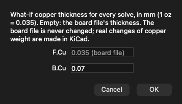
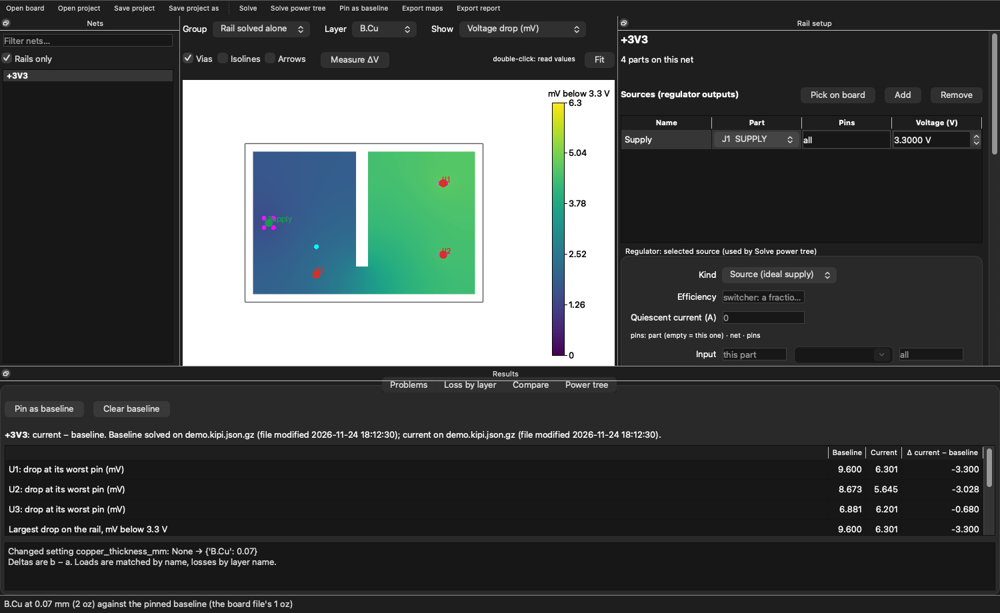
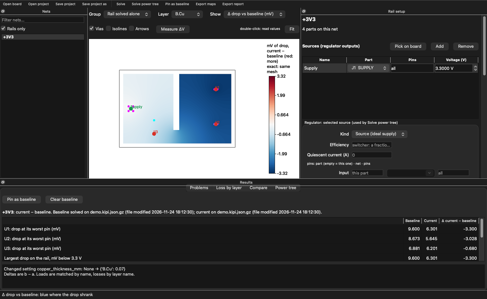
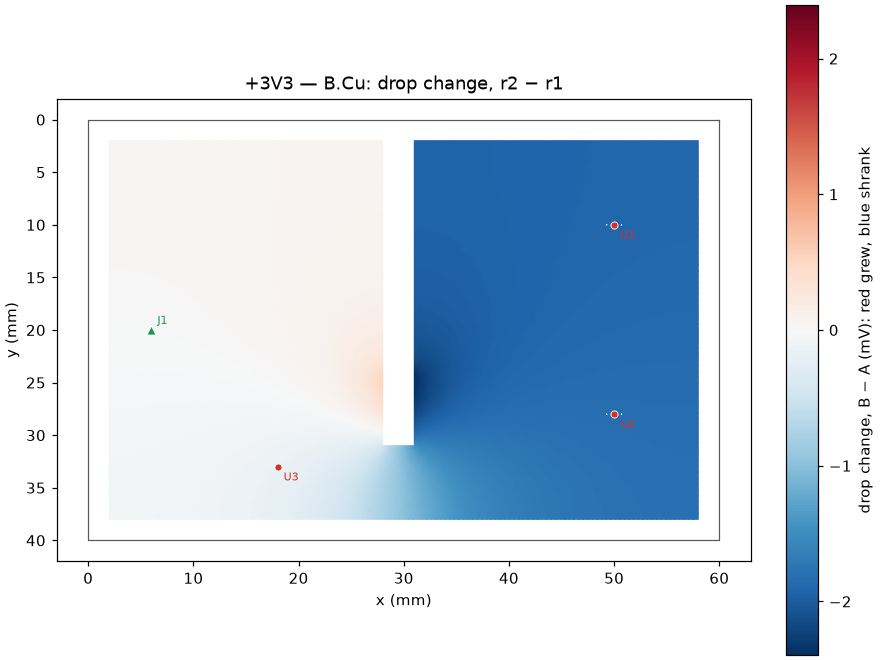

# What-if and compare

A solve tells you how the copper behaves today. The next question is what a change would do:
thicker copper on a layer, another via plating, a load drawing more, a wider neck in a plane.
Coppernicus answers it in three ways:

- a **what-if setting** on the same board: copper thickness, via plating, copper temperature,
  or the rail's own currents;
- **Pin as baseline** and **Compare** in the app, which put the new solve next to the old one;
- **revisions**: two board files, before and after a change made in KiCad, compared part by
  part and point by point.

The board file is never changed. A real change of copper weight, of the stack-up or of the
layout is made in KiCad, which then becomes the board that is solved.

## Copper thickness

Every copper layer's thickness comes from the board file. The **copper thickness** setting
replaces it on the layers you name, in mm (1 oz copper is 0.035, not 35), for every solve of
the project.

In the app it is in the solve settings: **Copper thickness → Edit…** opens one field per
copper layer, with the board file's value shown in grey. An empty field keeps the board file's
thickness.

<p align="center">
  
</p>

In the project file:

```yaml
settings:
  copper_thickness_mm:
    B.Cu: 0.07          # the board file is not changed; real changes are made in KiCad
```

- Values are in mm, above 0 and at most 1. A layer the board does not have stops the solve,
  with the board's copper layers in the message.
- The stack is rebuilt around the new thickness, so the via barrels get longer when it
  thickens (shorter when it thins). Even a net with no copper on the changed layer can move
  slightly through its vias: do not read that as a copper effect.
- Every result names the overridden layers in its assumptions, with the board file's value
  next to each:

  ```text
  What-if copper thickness (the copper_thickness_mm setting): B.Cu 0.07 mm (board file: 0.035 mm). The board file is not changed; real changes of copper weight are made in KiCad. ...
  ```

**AI agents** are held to one standard step. Through the MCP tools, `solve_rail` and
`write_project` accept on each layer only a standard weight (0.5, 1, 2 or 3 oz: 0.0175, 0.035,
0.070 or 0.105 mm) at most one step from the design's thickness; anything else is refused and
points to KiCad. `copper_step(result_id, layer, "up" | "down")` does the step from a result
and returns the comparison:

```text
One standard step of copper on B.Cu (1 oz → 2 oz), from the design's 0.035 mm; the board file is not changed and real changes of copper weight are made in KiCad (the stack-up), then solved again.
```

A bigger jump, a start that is not a standard weight, or a result that is already a what-if
is refused. The thickness you type in the app or in a project file stays free (up to 1 mm):
that is your own what-if. See [Agents](agents.md) for the tools.

## Pin as baseline and Compare

In the app:

1. Solve the rail.
2. Press **Pin as baseline** (Ctrl+B). The result shown becomes the "before".
3. Change something: a current, the via plating, the copper thickness, or the board itself in
   KiCad (then **File → Reload board**).
4. Solve again, and open the **Compare** tab.

The tab lists, for every load, its drop in the baseline and now, and the difference
(current − baseline); then the copper loss of each layer, and the settings that changed. On
the demo, with B.Cu from 1 oz to 2 oz:

<p align="center">
  
</p>

| Load | Baseline (mV) | B.Cu at 0.07 mm (mV) | Δ (mV) |
|---|---|---|---|
| U1 | 9.600 | 6.301 | −3.300 |
| U2 | 8.673 | 5.645 | −3.028 |
| U3 | 6.881 | 6.201 | −0.680 |

U3 gains the least: it is fed by a thin F.Cu track, and only the B.Cu part of its path got
thicker. The demo project's own 0.25 % limit, which U1 and U2 exceeded (0.29 % and 0.26 %),
now passes.

Set *Show* to **Δ drop vs baseline** to paint the difference on the board: red where the drop
grew, blue where it shrank. When both solves have the same mesh the map is exact; when the
board changed, the meshes differ and the map is interpolated, and its scale says which. A
double-click reads the change of drop at that point.

<p align="center">
  
</p>

**Loss by layer** draws the baseline's loss next to the current one. **Clear baseline**
forgets it.

Agents do the same with `compare_results(result_a, result_b)` on two results of the same
board. It warns when the two results' estimated draws differ, since the deltas would then mix
copper and current.

## Two revisions of a board

Before and after a change in KiCad, the two board files have different meshes, so a point of
one is not a point of the other. The agents' tool `compare_revisions(result_a, result_b)`
compares two results of different board files:

- each load's drop, matched by part;
- the copper loss of each layer;
- the vias, matched by position (within 0.01 mm) and drill, with the current of each;
- the second board's drop interpolated onto the first board's mesh: where it grew and where it
  shrank most, and one map per layer;
- what could not be matched: loads on one board only, copper one board has and the other has
  not (as an area, both ways).

For example, the demo board against a revision whose slot in the B.Cu plane ends 7 mm earlier,
so the neck below it is wider:

<p align="center">
  
</p>

| | Before | After | Δ |
|---|---|---|---|
| U1 drop | 9.600 mV | 7.699 mV | −1.902 mV |
| U2 drop | 8.673 mV | 6.847 mV | −1.826 mV |
| U3 drop | 6.881 mV | 6.869 mV | −0.012 mV |
| B.Cu loss | 22.92 mW | 16.38 mW | −6.55 mW |

The drop shrank most on the far side of the slot, at the height of its new end (−2.40 mV at
(31.0, 24.7) mm), and grew a little on the near side at the same height (+0.53 mV), where
current now turns the corner. The second board has 21.2 mm² of copper the first has not: the
part of the old slot that is now plane. All 9 vias match, and their currents change by 4 mA
at most.

A revision compare warns when both results come from the same board file (`compare_results`
is the tool for that), or when the settings differ, since the deltas would then mix the board
change and the settings.

## Documentation

- [Power tree](power-tree.md): regulators, ground return, groups and verdicts.
- [KiCad footprint fields](kicad-fields.md): the power data on the parts, in KiCad.
- [What-if and compare](what-if-and-compare.md): copper thickness, Pin as baseline, revisions.
- [HTML report](report.md): the offline page of a solve and of the power tree.
- [CI](ci.md): the GitHub Action for KiCad repositories.
- [Agents](agents.md): the MCP server and the `--json` command line for AI agents.
